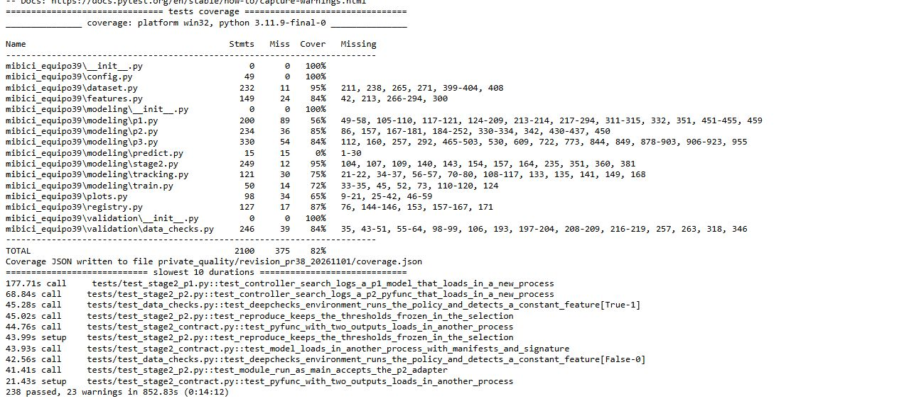
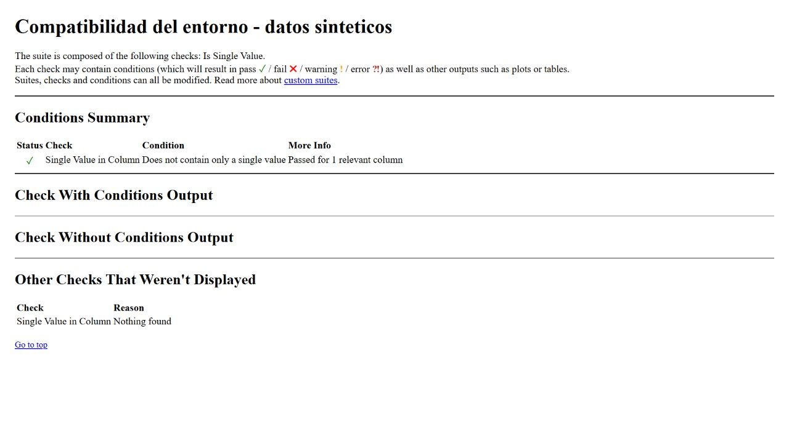
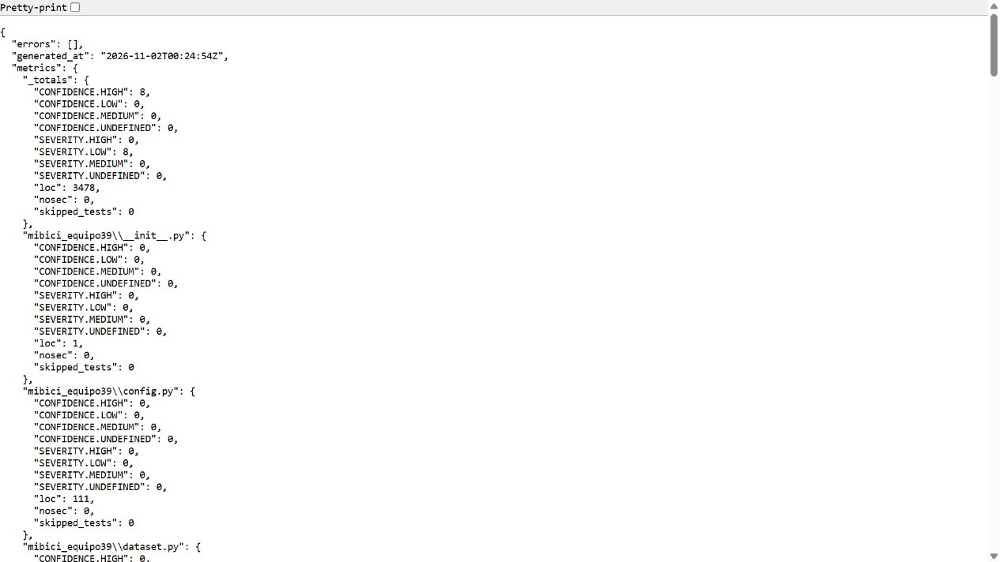

# Proyecto MiBici Equipo 39

## Etapa 5: monitoreo y comparación de versiones

El monitoreo de P1 conserva las entregas anteriores y utiliza octubre de 2026 como periodo nuevo. El protocolo, las fuentes y las versiones se registran en [references/etapa5](references/etapa5/). Las instrucciones están concentradas en [reproduccion.md](references/etapa5/reproduccion.md) y los resultados en [reports/etapa5](reports/etapa5/). La comparación es pareada y fuera de línea; no modifica automáticamente el modelo publicado.

Marco prepara datos, drift, entrenamiento y comparación. Diego Hurtado realiza la revisión independiente. Las aportaciones documentales de Stefania y Diego Martinez son acotadas y cuentan con respaldo, según la [distribución actual](references/etapa5/distribucion_actual.md).

**Resultado del 11 de noviembre de 2026:** 369 estaciones y 274,536 filas actuales; drift en 3 de 9 variables, asociado al calendario. B reduce el MAE de 1.239267 a 1.208781 (2.46%), pero no alcanza el umbral de promoción. Se conserva A como `champion`, versión 1, y B como candidata, versión 2. El [análisis de costo y estabilidad](reports/etapa5/analisis_ab.md) y la [recomendación de continuidad](reports/etapa5/recomendacion_ct.md) fueron aprobados por Diego Hurtado en el [PR #64](https://github.com/makroem/TC5061-Proyecto-Equipo39/pull/64#pullrequestreview-5884278942), integrado en `main` mediante `3fcca8a`.

**Verificación de este cambio:** 52 pruebas aprobadas (21 de monitoreo y 31 regresiones de ingesta), 16 advertencias; Bandit sin hallazgos en el módulo nuevo y auditoría de 82 dependencias de monitoreo sin vulnerabilidades conocidas. El [registro técnico](reports/etapa5/verificacion_tecnica.json) delimita el alcance; estas cifras no se suman a las pruebas históricas de las otras etapas. Las [nueve capturas originales](reports/etapa5/capturas/README.md), cuatro de Evidently y cinco de MLflow, están disponibles desde el 12 de noviembre. Muestran el drift, las versiones de P1, su linaje y la evaluación A/B de octubre. La revisión técnica independiente está aprobada. El [reporte editable](reports/etapa5/entrega/TC5061_Drift_ABTest_Equipo39.docx) y el [PDF de cinco páginas](reports/etapa5/entrega/TC5061_Drift_ABTest_Equipo39.pdf) reúnen los resultados y están pendientes de revisión documental de Diego Hurtado.

## Etapa 3: pruebas, validación y seguridad

La Etapa 3 del proyecto MiBici Equipo 39 cuenta con las correcciones técnicas de los cuatro integrantes integradas en `main`. La política de calidad permanece congelada.

**Resultado vigente:** verificación integrada del 7 de noviembre de 2026, ejecutada por Marco sobre el commit `e4ac4c6037d7150ac9b5ea1ba4812030b9e05d99`.

| Comprobación | Resultado vigente |
|---|---|
| PyTest de Etapa 3, excluyendo `tests/api` y `tests/monitoring` | **284 aprobadas**, 0 fallos, 0 errores, 0 omisiones |
| Advertencias de PyTest | 23, conservadas |
| Integración de DeepChecks | 2 pruebas incluidas en las 284 |
| Controles independientes de DeepChecks | Variable aceptada y constante rechazada como se esperaba |
| Bandit 1.9.4 | **9 LOW**, 0 MEDIUM, 0 HIGH, 0 errores de análisis |
| Validación histórica de datos reales | 100 PASS, 3 WARN, 0 FAIL, 0 NOT_EVALUATED; no repetida |
| API de Etapa 4 | 76 pruebas de alcance independiente; no se suman a las 284 |

La fuente canónica es [estado_vigente.json](reports/etapa3/estado_vigente.json). Los comandos, las capturas y el historial se describen a continuación. Los nueve hallazgos bajos de Bandit y las advertencias de datos permanecen documentados; estos resultados no certifican ausencia de vulnerabilidades.


### Reproducir la verificacion vigente

La comprobacion integrada fue ejecutada por Marco el 7 de noviembre de 2026, sobre el commit `e4ac4c6037d7150ac9b5ea1ba4812030b9e05d99`, con Python 3.11.9 en Windows.

**Preparacion:** se requieren dos entornos separados: `.venv-a7` (calidad, pruebas y seguridad) y `.venv-deepchecks` (compatibilidad). Los pasos de instalacion desde un clon limpio estan en la [guia unica de preparacion](references/etapa3/ejecucion_marco.md), que enlaza la adaptacion necesaria de DeepChecks. No mezclar las dependencias de ambos entornos.

Desde la raiz del repositorio, con los dos entornos preparados, ejecutar en PowerShell:

```powershell
$pythonCalidad = ".\.venv-a7\Scripts\python.exe"
$pythonDatos = ".\.venv-deepchecks\Scripts\python.exe"

& $pythonCalidad --version
& $pythonDatos --version
& $pythonCalidad -m pip check
& $pythonDatos -m pip check

$env:OMP_NUM_THREADS = "4"
$env:OPENBLAS_NUM_THREADS = "4"
$env:MKL_NUM_THREADS = "4"

$tempA7 = Join-Path ([IO.Path]::GetTempPath()) ("eq39_" + [guid]::NewGuid().ToString("N").Substring(0,8))
New-Item -ItemType Directory -Force -Path "private_quality/reproduccion_etapa3" | Out-Null

& $pythonCalidad -m pytest tests --ignore=tests/api --ignore=tests/monitoring -q --basetemp="$tempA7" --junitxml=private_quality/reproduccion_etapa3/pytest.xml

& $pythonDatos scripts/check_deepchecks_env.py --output private_quality/reproduccion_etapa3/deepchecks

& $pythonCalidad -m bandit -r mibici_equipo39 -f json -o private_quality/reproduccion_etapa3/bandit.json
```

Comprobar el codigo de salida de cada comando. PyTest y el control de DeepChecks deben terminar con codigo 0 cuando sus comprobaciones pasan. Bandit puede terminar con codigo 1 por hallazgos: revisar `results`, `errors` y severidades del JSON antes de interpretarlo como fallo del analisis.

Los resultados publicados son historicos y corresponden al commit probado. Una nueva ejecucion sobre otra version del codigo puede producir resultados distintos; debe registrarse su propio commit y fecha.

**Alcance:** los 284 casos históricos de Etapa 3 excluyen `tests/api` y la nueva carpeta `tests/monitoring`; incluyen dos pruebas de integracion de DeepChecks. Los controles independientes de DeepChecks no se suman a PyTest. El escaneo Bandit incluye `mibici_equipo39`, pero no `tests`; al añadir código de otra etapa, su resultado nuevo puede diferir del histórico.

Las 23 advertencias de PyTest son avisos de bibliotecas; los 9 LOW de Bandit son hallazgos de seguridad sujetos a interpretacion. No son fallos de validacion de datos. La validacion historica de CSV reales (100 PASS, 3 WARN) no se repitio.

La [verificacion original](reports/etapa3/verificacion_vigente_20261107.md) y el [resultado canonico](reports/etapa3/estado_vigente.json) conservan versiones, registros, advertencias y limitaciones.

### Evidencias visuales de la Etapa 3

Las siguientes capturas conservan su procedencia original. El resultado vigente corresponde al 7 de noviembre de 2026, commit `e4ac4c6037d7150ac9b5ea1ba4812030b9e05d99`. Las capturas historicas se identifican expresamente y no sustituyen los registros actuales.

**1. PyTest — captura historica (1 de noviembre de 2026)**



Captura del registro original de la ejecucion sobre `0dd8c6e`: 238 pruebas aprobadas y 23 advertencias. No representa la ejecucion vigente ni una consola en vivo. El [registro vigente del 7 de noviembre](reports/etapa3/registros_20261107/pytest.txt) confirma 284 aprobadas y 23 advertencias.

**2. DeepChecks — captura original (7 de noviembre de 2026)**



Captura original del HTML generado durante la comprobacion del commit `e4ac4c6`. El caso con columna variable cumple la condicion. El [caso constante rechazado como se esperaba](reports/figures/etapa3/cierre_20261107/deepchecks_constante.jpg) se conserva como evidencia complementaria. Son controles sinteticos de compatibilidad, no una nueva validacion de CSV reales.

**3. Bandit — captura historica (1 de noviembre de 2026)**



Captura del reporte original del cierre del 1 de noviembre: 8 hallazgos LOW, 0 MEDIUM, 0 HIGH y sin errores de analisis. El [reporte vigente del 7 de noviembre](reports/etapa3/registros_20261107/bandit.json), correspondiente a `e4ac4c6`, registra 9 LOW, 0 MEDIUM, 0 HIGH y cero errores. El aviso adicional pertenece al alcance de serving. La [interpretacion de seguridad](reports/etapa3/verificacion_vigente_20261107.md) documenta los riesgos residuales.

Las capturas historicas tienen sus huellas, fecha y procedencia en el [manifiesto original](reports/etapa3/capturas_finales_20261101.json). Las actuales de DeepChecks estan registradas en [estado_vigente.json](reports/etapa3/estado_vigente.json). Ninguna imagen debe interpretarse como una ejecucion realizada por Diego Hurtado.
### Contribuciones del equipo

| Responsable | Contribución | Evidencia |
|---|---|---|
| Marco | Entorno de calidad, ingesta, seguridad, dependencias y verificación del catálogo | [Avance técnico](reports/etapa3/avance_marco.md) |
| Stefania | Ampliación de pruebas de P1, calendario, partición y revisión de seguridad | [Revisión de P1](reports/etapa3/revision_p1_stefania.md) |
| Diego Martínez | Motor DeepChecks, política de calidad, pruebas de P2 y contratos del registro | [Calidad de datos](reports/etapa3/calidad_datos_diego_martinez.md) |
| Diego Hurtado | Pruebas adicionales de P3, perfiles horarios y análisis de seguridad | [Revisión de P3](reports/etapa3/revision_p3_diego_hurtado.md) |

Las contribuciones se integraron mediante los PR #31 (P3), #33 (P1), #35 (DeepChecks/P2) y #36 (verificación del catálogo y dependencias), además de las aportaciones iniciales de infraestructura y calidad.

### Aportaciones verificables de la corrección de Etapa 3

La corrección posterior del cierre de Etapa 3 se organizó en cuatro actividades. La autoría, las revisiones y la integración de cada PR se conservan en GitHub.

| Responsable | Actividad | PR y evidencia | Revisión |
|---|---|---|---|
| Diego Martínez | Tarea #51: corregir el manejo de errores de Git e interpretar los avisos Bandit del módulo de validación. | [PR #57](https://github.com/makroem/TC5061-Proyecto-Equipo39/pull/57) | Aprobado por Marco e integrado. |
| Stefania | Tarea #52: añadir pruebas de controles y fallos de trazabilidad en `git_state()`. | [PR #56](https://github.com/makroem/TC5061-Proyecto-Equipo39/pull/56) | Aprobado por Marco después de solicitar correcciones; integrado. |
| Marco | Tarea #53: ejecutar la verificación integrada y publicar los resultados vigentes de calidad y seguridad. | [PR #59](https://github.com/makroem/TC5061-Proyecto-Equipo39/pull/59) | Aprobado por Diego Hurtado e integrado. |
| Diego Hurtado | Tarea #54: simplificar el README, consolidar los resultados, incorporar las evidencias visuales y documentar la colaboración. | [PR #60](https://github.com/makroem/TC5061-Proyecto-Equipo39/pull/60) | Autoría y revisión independiente consultables en el PR #60. |

La integración de los PR #56, #57 y #59 se verificó en GitHub. La consolidación documental de la tarea #54 se registra en el [PR #60](https://github.com/makroem/TC5061-Proyecto-Equipo39/pull/60), donde puede consultarse su revisión y estado de integración. Las tareas [#53](https://github.com/makroem/TC5061-Proyecto-Equipo39/issues/53) y [#54](https://github.com/makroem/TC5061-Proyecto-Equipo39/issues/54) documentan la comprobación técnica y el estado del cierre, respectivamente.


### Historial de verificaciones anteriores

Las cifras siguientes corresponden a ejecuciones distintas. Se conservan como antecedentes y no sustituyen el resultado vigente de 284 pruebas.

| Pruebas aprobadas | Procedencia | Interpretación |
|---|---|---|
| 229 | [Verificación de desarrollo de Diego Martínez](reports/etapa3/calidad_datos_diego_martinez.md) | Suite combinada durante el desarrollo |
| 238 | [Cierre integrado del 1 de noviembre](reports/etapa3/cierre_integrado_marco_20261101.md) | Verificación integrada y revisión posterior de dependencias |
| 245 | [Cierre adicional de compatibilidad](reports/etapa3/cierre_adicional_marco.md) | Suite posterior al ajuste de DeepChecks |

La cobertura histórica de 82.14 % corresponde al cierre de 238 pruebas y no fue recalculada durante la verificación vigente. La validación real de 100 PASS y 3 WARN se conserva en su registro original.


### Validación de calidad con DeepChecks

El motor se implementa en:

`mibici_equipo39/validation/data_checks.py`

La política de calidad se encuentra en:

`references/etapa3/quality_policy.json`

La política fue congelada con `frozen: true`, después de la revisión de criterios de P1 y P3 por sus responsables, sin modificar las reglas ni los umbrales acordados.

El motor identifica cuatro estados:

| Estado | Interpretación |
|---|---|
| PASS | Comprobación satisfactoria |
| WARN | Advertencia que requiere interpretación |
| FAIL | Incumplimiento del criterio definido |
| NOT_EVALUATED | Comprobación no ejecutada, con causa registrada |

La ejecución de desarrollo documentada reportó 64 PASS, 2 WARN y 1 FAIL. El FAIL se relaciona con una discrepancia de hash del catálogo de estaciones en macOS ARM, investigada y contrastada con el entorno Windows. El resultado original se conserva sin modificar los manifiestos para ocultar la diferencia.

La etapa `final` se ejecutó una sola vez sobre el código integrado y los datos oficiales, con la política congelada. El [resumen original](reports/etapa3/validacion_final_datos_20261101.json) conserva todas las comprobaciones. Las tres advertencias corresponden a variables constantes de P3 y permanecen visibles.

### Seguridad y dependencias

La revisión vigente de Bandit 1.9.4 identifica nueve hallazgos LOW: tres del módulo de validación, cinco de entrenamiento y uno de serving, sin hallazgos MEDIUM/HIGH y sin errores de análisis.

Los casos de validación tienen una [interpretación individual de sus riesgos y controles](reports/etapa3/seguridad_validacion.md). El [reporte de verificación vigente](reports/etapa3/verificacion_vigente_20261107.md) documenta el alcance completo, las exclusiones y las limitaciones.

Las advertencias de PyTest son diferentes de los avisos de seguridad y de los tres WARN históricos de calidad de datos. Ninguna de estas categorías debe mezclarse o presentarse como ausencia absoluta de riesgos.


### Documentación y evidencias

- [Contrato de calidad de la Etapa 3](references/etapa3/contrato_calidad.md)
- [Instalación y ejecución de verificaciones](references/etapa3/ejecucion_marco.md)
- [Matriz inicial de pruebas](reports/etapa3/matriz_pruebas.md)
- [Entorno de DeepChecks](references/etapa3/deepchecks_entorno.md)
- [Hallazgos de seguridad](reports/etapa3/hallazgos.md)
- [Migración de MLflow y PyArrow](references/etapa3/migracion_mlflow_pyarrow.md)
- [Verificación de estaciones entre entornos](references/etapa3/verificacion_estaciones.md)
- [Capturas preliminares y su procedencia](reports/etapa3/evidencias_marco.md)
- [Manifiesto de evidencias](reports/etapa3/evidencias_manifest.json)
- [Consolidación de evidencias de la Etapa 3 — Diego Hurtado](reports/etapa3/evidencias_consolidadas_diego_hurtado.md)

Las capturas preliminares documentan pruebas y verificaciones anteriores a la integración completa. Sus fechas, alcance y procedencia deben conservarse y distinguirse de las capturas de la validación final.

### Estado documental del cierre

El cierre técnico de Etapa 3 está documentado mediante el [PR #59](https://github.com/makroem/TC5061-Proyecto-Equipo39/pull/59), aprobado e integrado. Los resultados y capturas anteriores conservan sus fechas y procedencia.

Las correcciones de seguridad y trazabilidad de las tareas #51 y #52 también están integradas. La documentación histórica no se reescribe ni se presenta como una nueva ejecución.

Las evidencias visuales originales y su consolidación se incorporaron anteriormente mediante los PR #40 y #41. El [PR #50](https://github.com/makroem/TC5061-Proyecto-Equipo39/pull/50) de cierre de API también está integrado en `main`.

La tarea #54 consolida los resultados vigentes, las evidencias y la colaboración en este README. La revisión independiente y el estado de integración de esta aportación pueden consultarse en el [PR #60](https://github.com/makroem/TC5061-Proyecto-Equipo39/pull/60).

Los hallazgos LOW documentados conservan sus controles, limitaciones y seguimiento. La aprobación documental no equivale a una certificación de seguridad.


## Estado de integración de la Etapa 2

La Etapa 2 utiliza un controlador común de experimentación,
MLflow Projects y Model Registry. Los ADAPTERS de P1, P2 y P3 están integrados; P1 se incorporó mediante el PR #16.

El controlador común y el registro de modelos se integraron
mediante el PR #12. La implementación de P2 se incorporó
mediante el PR #13. Las mejoras de P3 y su conexión con
el controlador se incorporaron mediante los PR #11 y #14.

La configuración de candidatos se encuentra en
`config.STAGE2_SEARCH_PLAN`, y los puntos de entrada de
experimentación y registro están definidos en `MLproject`.

La arquitectura técnica de esta etapa se documenta en
[Arquitectura de la Etapa 2](references/etapa2/arquitectura.md).

Las condiciones del entorno y del servidor se describen en
[Contrato de infraestructura](references/etapa2/contrato_infraestructura.md).

El [punto de partida](references/etapa2/starting_point.json)
conserva los resultados históricos utilizados como referencia.
Estos resultados no sustituyen las nuevas corridas oficiales
de la Etapa 2.

Las pruebas automatizadas verifican la implementación,
pero no acreditan por sí solas la selección oficial de
modelos, su registro como champion ni la reproducción final.

### Cierre técnico del 27 de octubre de 2026

El PR #22 quedó integrado después de las revisiones de Stefania, Diego Martinez y Diego Hurtado. Las tres selecciones se reprodujeron con métricas coincidentes y los modelos se registraron como versión 1 con alias `champion`. Su carga por nombre y predicciones se comprobaron en una ejecución independiente de MLflow Projects. El PR #24 incorporó la justificación de P3 revisada por Marco.

El [PR #25](https://github.com/makroem/TC5061-Proyecto-Equipo39/pull/25), revisado e integrado por Diego Hurtado, incorporó las evidencias de reproducción y registro. El [PR #26](https://github.com/makroem/TC5061-Proyecto-Equipo39/pull/26), de Diego Hurtado y revisado e integrado por Marco, completó la [interpretación de los perfiles horarios y el mapa de P3](reports/etapa2/p3.md). Ambas actividades están cerradas.

El [cierre técnico y sus evidencias](reports/etapa2/cierre_tecnico_marco.md) conserva corridas, versiones, linaje, comandos y límites. Las [19 capturas de la interfaz](reports/etapa2/capturas_mlflow_marco.md) documentan búsquedas anidadas, comparaciones, artefactos y las tres versiones registradas con alias y linaje. Queda revisar este conjunto e incorporarlo al Word y PDF consolidados. El envío en Canvas no está verificado.

Repositorio público: https://github.com/makroem/TC5061-Proyecto-Equipo39

## Propósito y alcance
P1 estima salidas por estación en la siguiente hora; P2 aproxima riesgo de bicicletas o anclajes; P3 agrupa estaciones por uso. El código final vive en `mibici_equipo39`; los notebooks son exploratorios. Los modelos historicos de P1/P2/P3 y su evaluacion cronologica se integraron mediante los PR #8 y #3. Los tres ADAPTERS de la Etapa 2 también están integrados, incluida la aportación de P1 del PR #16. El estado de integración, las revisiones y las dependencias restantes se registran en references/cierre_marco.md.

## Equipo roles y contribuciones
Marco (`makroem`, persona1): infraestructura del proyecto, ingesta, versionado de datos, evaluación temporal, implementación inicial de P3 y coordinación de integración.

Stefania (`a01236059-lab`, persona2): propuesta de variables, ML Canvas, exploración de P1 y participación en las revisiones de integración.

Diego Martínez (`Sanciprian`, persona3): integración de variables y modelos, desarrollo de P2 para la Etapa 2, controlador común de experimentación, registro de modelos y puntos de entrada de MLflow Projects (PR #12 y #13).

Diego Hurtado (`diegoHurtado01`, persona4): preparación experimental de P3 para la Etapa 2, incorporación de variantes KMeans y Gaussian Mixture, métricas de estabilidad y costo, artefactos interpretables y pruebas automatizadas (PR #11). Implementación del ADAPTER de P3 para el controlador común (PR #14). Revisión formal del controlador y de P2 mediante los PR #12 y #13. Responsable de la documentación de arquitectura y consolidación del reporte de experimentos de la Etapa 2.

Las contribuciones integradas conservan su autoría en Git y GitHub. Las corridas oficiales, las selecciones aprobadas, su reproducción y la carga por alias se documentan en el cierre técnico, con evidencia independiente de las pruebas automatizadas.
## Preguntas y usuarios
| Pregunta | Resultado | Usuario y decisión |
|---|---|---|
| P1 Regresión | Salidas en estación durante [t,t+1 hora) | Operador, planeación de flota |
| P2 Clasificación | Dos riesgos proxy en la siguiente hora | Rebalanceo, priorizar inspecciones |
| P3 Clustering | Grupo de estación según su perfil histórico | Planeación urbana, interpretar patrones |

P2 no observa inventario. Parte de 50% de capacidad y etiqueta presión si el flujo intrahora llega a 10% o 90%. No prueba que una estación estuviera realmente vacía o llena. La capacidad/ubicación del catálogo de septiembre se usa retrospectivamente; no acredita su historial de cambios ni entra como predictor de P1/P2.

## Fuentes tamaño uso y privacidad
Fuente: https://mibici.net/es/datos-abiertos/. Doce CSV de octubre de 2025 a septiembre de 2026 y nomenclatura_2026_09.csv. Los trece enlaces exactos y SHA256 se registran en `references/data_manifest.json`. Son 4,497,877 filas originales, 4,497,119 viajes completos retenidos, 484 estaciones de catálogo y 480 con capacidad válida. La malla cruza estaciones observadas y catálogo; la elegibilidad de P1/P3 se decide solo con train.

La ingesta elimina identificadores de usuario y variables demográficas. Los originales, Parquet, modelos y almacén MLflow quedan fuera de Git. MIT cubre el código; no se atribuye a los CSV una licencia específica no identificada. Se reconoce a MiBici como fuente y no se redistribuyen CSV. Falta confirmar con el titular las condiciones adicionales antes de otros usos.

## Partición y temporalidad
`chronological_holdout` versión 3: train de octubre 2025 a mayo 2026 (243 días), validación junio-julio (61), test agosto-septiembre (61). Se eligen meses completos contiguos para que test sea posterior al ajuste, en lugar de una proporción aproximada 70/15/15. Este único holdout no mide todos los regímenes estacionales.

La data_version no cambia. Se cambia split_id y se incorpora todo octubre, sin el antiguo descarte de ocho días. `references/split_manifest_random_days_v2.json` conserva el manifiesto anterior solo como historia. El proceso normal verifica el nuevo manifiesto sin sobrescribirlo. Las ocho entradas de P1/P2 son calendario conocido al predecir; modelos, codificadores y elegibilidad se ajustan solo en train. Selección y umbrales usan validación. Test no modifica el diseño.

## Pipeline y métricas de referencia (Etapa 1)
| Pregunta | Baseline | Candidato | Selección previa a prueba |
|---|---|---|---|
| P1 | Media train estación/día/hora con respaldos | HGB Poisson y TargetEncoder train | Menor val_mae, empate baseline |
| P2 | DummyClassifier prior por riesgo | Logística balanceada por riesgo | Mayor val_macro_f1, empate baseline |
| P3 | KMeans k=3 | GaussianMixture diagonal k=3 | Mayor val_silhouette con grupos train de al menos 5%; si ninguno cumple, ninguno |

P1 evalúa MAE/RMSE. P2 evalúa precisión/recall/F1/AP, matrices de confusión y sensibilidad a ocupación 25%/75%. El umbral de P2 se busca solo en validación con recall objetivo 0.80; si ningún umbral lo alcanza se usa mayor F1. Una precisión baja puede hacer inviables los rebalanceos aunque mejore F1.

P3 genera 48 medias horarias por estación (24 laborales y 24 de fin de semana), incluyendo ceros. Normaliza cada tipo de día a suma uno y ajusta StandardScaler solo con train. Exige 100 viajes de train. Las coordenadas no entran al agrupamiento. Evalúa silhouette, Davies Bouldin, tamaño de grupos y estabilidad ARI con cinco remuestreos de días train. El mapa es un diagrama de puntos sin base cartográfica; los grupos no prueban causas o impacto urbano.

## Estructura arquitectura y herramientas
La estructura original se generó con ccds 2.3.0, include_code_scaffold Yes (evidencia histórica en main). `data/` es local; `notebooks/` exploración; `mibici_equipo39/` código; `models/` modelos locales; `references/` manifiestos/Canvas/diagrama; `reports/` reportes/figuras. El diagrama está en `references/arquitectura.svg` y el Canvas en `references/ml_canvas.md`.

Python 3.11.9/pandas permiten funciones y bloques de 100,000 filas; PyArrow/Parquet tablas tipadas por mes; scikit-learn pipelines y métricas; MLflow trazabilidad de experimentos; GitHub revisión y autoría. `config.py` centraliza rutas, fechas, semillas e hiperparámetros. Las referencias oficiales sustentan las herramientas; falta relacionarlas con las lecturas asignadas del curso cuando estén disponibles.

## Instalación
Requiere Git y Python 3.11.9. Comprueba primero sus versiones y reutiliza las instalaciones disponibles. Clona la rama main integrada:

```bash
git clone --branch main https://github.com/makroem/TC5061-Proyecto-Equipo39.git
cd TC5061-Proyecto-Equipo39
python -m venv .venv
```

Activa `.venv` con `.venv\Scripts\Activate.ps1` en PowerShell o `source .venv/bin/activate` en Linux/macOS:

```bash
python -m pip install -r requirements.txt
python -m pip install --no-deps -e .
python -m pip check
```

requirements.txt fija versiones; pywin32 solo aplica a Windows. Se recomiendan OMP_NUM_THREADS=4, OPENBLAS_NUM_THREADS=4 y MKL_NUM_THREADS=4 para limitar recursos, sin cambiar semillas o partición. La ingesta descarga unos 390 MB y requiere espacio adicional para Parquet/tablas.

## Ingesta variables y pruebas
Desde la raíz y con el entorno activado:

```bash
python -m mibici_equipo39.dataset --verify-manifest
python -m mibici_equipo39.features
python -m pytest tests -q
```

La ingesta descarga sin pasos manuales, normaliza columnas/codificación/fechas, comprueba trece fuentes y hashes lógicos. `--freeze-manifest` solo se usa para aprobar una versión nueva de datos. Las pruebas cubren temporalidad, aislamiento, manifiestos, proxy P2, perfiles P3 y trazabilidad. Si el temporal del sistema tiene permisos incorrectos, usa una carpeta nueva con `--basetemp=../pytest-mibici-nuevo`.


## Experimentación de la Etapa 2 con MLflow Projects

La Etapa 2 utiliza el punto de entrada `train` de `MLproject` y el
controlador `mibici_equipo39.modeling.stage2`.

El controlador recibe la pregunta (`p1`, `p2` o `p3`), el modelo,
los hiperparámetros, el integrante responsable y el modo de ejecución.

### Configuración de MLflow

Esta rama utiliza MLflow 3.17.2 y PyArrow 23.0.1. Antes de conectar el entorno nuevo a una base existente de MLflow 2, seguir el [procedimiento de migración sobre una copia](references/etapa3/migracion_mlflow_pyarrow.md). El servidor oficial anterior no se actualiza automáticamente con la instalación de estas dependencias.

El 30 de octubre de 2026 se activó y verificó el servidor local migrado después de
integrar el PR #32. Se conservaron 34 corridas, 500 archivos de artefactos y los
tres modelos `champion`; el almacén anterior y el respaldo permanecen intactos.
El [registro de activación](reports/etapa3/activacion_servidor_20261030.json)
documenta el alcance y los horarios. El endpoint `http://127.0.0.1:5000` corresponde
a la máquina que aloja el servicio; la pausa de escrituras ya terminó.

El repositorio debe estar limpio y los datos procesados y manifiestos
deben encontrarse disponibles antes de iniciar una búsqueda.

En PowerShell, para utilizar el servidor configurado según el
contrato de infraestructura:

```powershell
$env:MLFLOW_TRACKING_URI = "http://127.0.0.1:5000"
$env:MLFLOW_REGISTRY_URI = $env:MLFLOW_TRACKING_URI
$env:MIBICI_RESULTS_DIR = Join-Path $env:LOCALAPPDATA "MiBiciEquipo39\resultados"
```

El servidor debe estar iniciado y el usuario debe contar con acceso
al almacén correspondiente. Las corridas de prueba no sustituyen
las corridas oficiales del equipo.

### Búsqueda de modelos

Ejemplo de búsqueda de P3 ejecutada por Diego Hurtado:

```powershell
mlflow run . -e train --env-manager local --experiment-name mibici-equipo39 -P question=p3 -P model=search -P member=DiegoHurtado -P mode=search
```

La búsqueda compara el baseline y las tres variantes candidatas
configuradas en `config.STAGE2_SEARCH_PLAN`.

Los modelos se ajustan con train y se seleccionan con validation.
Antes de consultar test, la selección se registra en
`evaluation/selection_before_test.json`.

Si ninguna variante cumple la regla de elegibilidad, la búsqueda
termina sin evaluar test.

### Calibración de P2

P2 utiliza `fit(train)` y posteriormente `calibrate(validation)` antes de seleccionar la variante y evaluar test. Se establecen umbrales independientes para bicicletas y anclajes, priorizando precisión con recall mínimo de 0.80 y utilizando F1 como alternativa cuando ningún umbral cumple.

La calibración se registra antes de test. En una reproducción se reutilizan los umbrales congelados en `references/etapa2/selection.json`.

### Reproducción de una selección aprobada

La reproducción requiere el archivo oficial
`references/etapa2/selection.json`, que contiene la variante y
sus hiperparámetros congelados.

```powershell
mlflow run . -e train --env-manager local --experiment-name mibici-equipo39 -P question=p3 -P model=selected -P member=DiegoHurtado -P mode=reproduce
```

Este procedimiento no realiza una nueva búsqueda ni modifica
los hiperparámetros utilizando test.

### Desempate por costo de P3

El PR #18 integró al controlador común el contrato
`tie_break()` para resolver empates mediante criterios
específicos de cada ADAPTER, preservando la prioridad
del baseline.

El PR #19 implementó e integró esta regla en P3:
entre candidatos elegibles con igual métrica de selección,
se prioriza el menor tiempo de inferencia por 1,000
observaciones de validación y posteriormente el menor
tamaño serializado del modelo. El conjunto test no
participa en el desempate.

El PR #19 fue aprobado por Marco e integrado en `main` mediante el commit `4ad9e03`.


### Reproducción completa y registro

La [guía de reproducción](reports/etapa2/reproduccion.md) describe instalación, almacén independiente, validación y límites de disponibilidad de los datos. Con el entorno fijo instalado y las variables de tracking configuradas:

```powershell
mlflow run . -e reproduce --env-manager local --experiment-name mibici-equipo39 -P member=Marco -P approved_registry_uri=sqlite:///private_tracking/reproduccion.db
```

El punto de entrada encadena ingesta, reproducción de las tres selecciones, registro y carga por alias. Obtiene los identificadores de las corridas recién generadas; no requiere `Read-Host` ni copiar un `run_id`. `references/etapa2/selection.json` ya contiene las selecciones aprobadas y sus umbrales. No se edita durante una reproducción.

El registro está bloqueado por defecto. `approved_registry_uri` autoriza expresamente el destino y debe coincidir exactamente con `MLFLOW_REGISTRY_URI` (o con el tracking si no se definió un Registry separado). El valor literal del ejemplo autoriza solo la base independiente indicada: una configuración hacia el servidor oficial se rechaza antes de iniciar los pasos. MLflow Projects puede crear la corrida contenedora antes de esa comprobación, pero no se inicia la ingesta ni se registran modelos o cambian alias. El parámetro se registra en MLflow; no incluir credenciales en la URI.

El registro se realiza en el almacén configurado. Para una comprobación usar una base independiente, como indica la guía, y no el servidor oficial. El 2 de noviembre de 2026 la descarga nueva del catálogo respondió 404; la prueba con copias históricas verificadas no elimina esa limitación externa.

### Reporte corregido

El [reporte editable](reports/etapa2/ReporteParte2_MLflow_Equipo39.docx) y su [PDF](reports/etapa2/TC5061_Reporte_MLFlow_Equipo39.pdf) integran las tablas y capturas oficiales, el análisis de costo y estabilidad y la distinción entre evidencia histórica y validación del flujo actual. Las correcciones se implementan por Marco y su revisión independiente corresponde a Diego Hurtado.

### Evidencia y resultados

MLflow conserva las corridas padre e hijas, métricas, parámetros,
etiquetas, modelos, firmas y artefactos de interpretación.

Las búsquedas y reproducciones generan resúmenes en el directorio
privado configurado por `MIBICI_RESULTS_DIR`.

Las evidencias oficiales deben identificar el commit, la versión
de los datos, la partición, las corridas y el modelo seleccionado.

### Compatibilidad con la primera entrega

Los puntos de entrada históricos `p1`, `p2`, `p3` y `main` siguen
disponibles en `MLproject`. No sustituyen al controlador `train`
de la Etapa 2.

La arquitectura y sus componentes se describen en
[Arquitectura de la Etapa 2](references/etapa2/arquitectura.md).


## Git GitHub y buenas prácticas
main está protegida: una aprobación, descarte de aprobaciones antiguas y conversaciones resueltas; force push y eliminación bloqueados también para administradores. Todo cambio hacia main debe pasar por PR revisado. Ramas feat/fix/docs/chore y commits con esos prefijos. Cada persona debe abrir un PR y revisar otro; una ejecución de Marco no sustituye la evidencia de otros.

El PR #8 se incorporó a la rama de integración y el PR #3 se incorporó a main en el commit de5d622707254e275369d3e7c60d340523ce33ce. El PR #5 se cerró sin merge para evitar sobrescribir la versión consolidada. Las contribuciones y revisiones conservan su historial. Los PR #6/#7 anteriores entraron a esa rama sin revisión formal registrada; no se declara una revisión inexistente ni se evade la protección. Los notebooks antiguos con días aleatorios son historia exploratoria y no acreditan las métricas cronológicas.

## Resultados limitaciones y cierre
La propuesta consolidada está disponible en [PDF](reports/TC5061_Propuesta_Proyecto_Equipo39.pdf) y [Word editable](reports/TC5061_Propuesta_Proyecto_Equipo39.docx). El [informe de cierre y pendientes](reports/Cierre_Actividades_y_Pendientes.txt) distingue las actividades integradas de la colaboración individual restante, las lecturas y las condiciones de uso por confirmar. El envío en Canvas no está verificado en GitHub. Ambos documentos incluyen el enlace público al repositorio; el código consolidado se consulta en main. El registro de Marco está en [references/cierre_marco.md](references/cierre_marco.md).

Las métricas históricas de la primera entrega se documentan en el resumen y el PDF. No constituyen resultados oficiales de la Etapa 2. No deben mezclarse con mibici-equipo39-revision-marco, de días aleatorios. Se requieren capturas de lista, detalle con parámetros/métricas/etiquetas, artefacto y comparación, además de estructura del repositorio y referencias APA 7.

La ejecución de cierre terminó el 18 de octubre de 2026 desde MLflow Projects, en el commit ad74ba344bdfe6770a12ef37577fa7403c54dbc6, con seis runs finalizados, git_dirty=false y 39 pruebas aprobadas. La evidencia está en reports/cierre_experimentos.json y references/evidence/.

Resultados: P1 conserva baseline (val_mae 0.888775; test_mae 0.916381; test_rmse 1.718234). P2 selecciona logística (val_macro_f1 0.042048; test_macro_f1 0.051779); en test, recall de bicicletas 0.8541 y de anclajes 0.7932, con precisión 0.0218/0.0318. P3 selecciona GMM para 369 estaciones (val_silhouette 0.026594; test_silhouette 0.051373; ARI medio de remuestreo train 0.637608). Los grupos se superponen y no se presume que estén suficientemente separados para decisiones operativas.

Limitaciones: proxy P2 sin inventario, capacidad/ubicación retrospectivas de septiembre, estaciones nuevas sin train excluidas, un año de fuentes y un holdout temporal. No hay despliegue ni impacto operativo demostrado. Las aportaciones de Diego Hurtado se integraron mediante los PR #11 y #14. La selección oficial, la reproducción y el registro de la Etapa 2 se documentan por separado en el [cierre técnico](reports/etapa2/cierre_tecnico_marco.md).

## Relación parcial con las lecturas
La introducción pública de Wilson, capítulo 6, respalda la comparación objetiva de alternativas; se conserva el baseline de P1 aunque exista un candidato más complejo. La vista pública de Thompson, capítulo 7, distingue crear un modelo de demostrar su utilidad y enumera seguimiento de experimentos y repositorios en 7.4.2; se aplica con MLflow y con límites operativos explícitos. Solo se consultaron estas vistas públicas, no los capítulos completos ni Lauchande 5 o Huyen 6. Falta contrastar las cuatro lecturas asignadas.

- Wilson: https://livebook.manning.com/book/machine-learning-engineering-in-action/chapter-6
- Thompson: https://livebook.manning.com/book/managing-machine-learning-projects/chapter-7

## Etapa 4: preparación del modelo para la API

Marco preparó la recuperación de P1 y completó los esquemas, el adaptador, la API y el Containerfile. El [contrato vigente](references/etapa4/contrato_api.md) describe el servicio. La [distribución actual](references/etapa4/distribucion_actual.md) deja a Marco y Diego Hurtado el trabajo crítico y revisiones acotadas a Stefania y Diego Martinez.

El [índice de entrega de la Etapa 4](reports/etapa4/indice_entrega_marco.md) reúne actividades, archivos y evidencias. El servicio y las capturas finales están integrados mediante los PR #49 y #50, revisados por Diego Hurtado. Las revisiones de ejemplos de Stefania (PR #55) y de uso de Diego Martinez (PR #58) también están integradas y fueron revisadas por Marco.

El [PR #49](https://github.com/makroem/TC5061-Proyecto-Equipo39/pull/49) ya está integrado tras la revisión independiente de Diego Hurtado. Marco comprobó el commit `b1ddc47` desde un clon y un entorno de Python nuevos: instalación correcta, 76 pruebas aprobadas, contenedor Linux saludable y 72 casos HTTP sin diferencias. El [cierre sobre main](reports/etapa4/cierre_api_marco_20261103.md#cierre-sobre-main) incluye la inspección del contenedor y las capturas originales de esa ejecución.

### Entorno de servicio

Comprueba primero `python --version` (3.11.9) y si ya existe `.venv-api`. Solo si falta, créalo. Después instala las versiones fijadas:

```powershell
python -m venv .venv-api
$pythonApi = '.venv-api\Scripts\python.exe'
& $pythonApi -m pip install -r requirements-api-dev.txt
& $pythonApi -m pip check
```

`requirements-api.txt` usa MLflow Skinny 3.17.2 para cliente y carga local, más las dependencias de P1 y FastAPI. No instala un servidor de tracking. El servidor oficial conserva su entorno completo anterior. El modelo mantiene intacto su archivo histórico de dependencias; MLflow puede advertir diferencias con ese entorno. Se comprobó paridad en Windows y desde la imagen Linux: 72 casos por HTTP con diferencia máxima 0.0. La construcción verifica además la integridad y la carga del paquete; el registro de implementación enlazado al final conserva los resultados.

### Recuperar exactamente el modelo aprobado

Usa el servidor oficial iniciado según la sección de MLflow; `127.0.0.1` se refiere a la computadora que aloja ese servidor. Otro integrante necesita acceso autorizado al mismo Registry y sus artefactos, no una base vacía. No hay un servidor público compartido configurado por esta entrega.

```powershell
$env:MLFLOW_TRACKING_URI = 'http://127.0.0.1:5000'
$env:MLFLOW_REGISTRY_URI = $env:MLFLOW_TRACKING_URI
& $pythonApi -B -m mibici_equipo39.serving.export_model --manifest references/etapa4/model_manifest.json --output models/serving/p1
& $pythonApi -B -m mibici_equipo39.serving.verify_model
```

El primer comando descarga la versión numérica fijada y verifica las 22 huellas. Si ya está presente, comprueba el paquete sin sobrescribirlo. El segundo compara 72 entradas de calendario con una carga independiente por nombre y versión desde el Registry, verifica repetición y prueba la carga local con solicitudes de red bloqueadas. No solicita un run_id ni ejecuta entrenamiento.

Para ampliar la comprobación a cinco estaciones conocidas, una desconocida, los doce meses, los siete días y las 24 horas:

```powershell
& $pythonApi -B -m mibici_equipo39.serving.verify_model --profile extended
if ($LASTEXITCODE -ne 0) { throw 'La comparación ampliada no terminó correctamente.' }
```

Este perfil comprueba 12,096 entradas artificiales y guarda `reports/etapa4/paridad_modelo_ampliada_marco.json`, separado del resultado básico. Las estaciones conocidas se contrastan con las tablas del baseline antes de predecir. Se obtuvo diferencia máxima 0.0 en Windows; esto no mide exactitud frente a viajes reales ni demuestra compatibilidad Linux. El mes no interviene en las medias del baseline elegido. Resultados, versión del código y pendientes: [seguimiento de la comprobación ampliada](reports/etapa4/seguimiento_marco_20261102.md).

Para preparar una selección nueva se utiliza `--name mibici-equipo39-p1-demanda --alias champion --output <destino-nuevo> --manifest-out <manifiesto-nuevo>`, después de una revisión del cambio. No sobrescribas el manifiesto de esta entrega para seguir un alias que haya cambiado.

#### Recibir el paquete original para revisar Docker sin acceso al Registry

Si tu almacén local no contiene la versión aprobada, solicita a Marco la copia `Paquete_P1_Equipo39_v1_22archivos.zip` por el canal acordado por el equipo. El archivo contiene únicamente los 22 archivos originales bajo `models/serving/p1/`; el manifiesto de confianza se obtiene del repositorio, no del ZIP. No publiques el modelo ni los detalles de acceso en Git.

Descarga el ZIP recibido a Descargas, abre PowerShell en la raíz de tu clon y activa el entorno de servicio descrito arriba. Comprueba la huella antes de extraer; si ya tienes `models/serving/p1`, verifica esa copia o utiliza otro clon, sin sobrescribirla.

```powershell
$pythonApi = '.venv-api\Scripts\python.exe'
$paqueteP1 = Join-Path ([Environment]::GetFolderPath('UserProfile')) 'Downloads\Paquete_P1_Equipo39_v1_22archivos.zip'
$huellaP1 = (Get-FileHash -LiteralPath $paqueteP1 -Algorithm SHA256).Hash.ToLowerInvariant()
if ($huellaP1 -ne '5dbd9112b837fb6b4594d91c2db3f9660962f04c4e0f279219b8bba3f76d9925') { throw 'El ZIP no coincide con la copia original.' }
if (Test-Path -LiteralPath 'models/serving/p1') { throw 'El destino ya existe; verificarlo o usar otro clon.' }
Expand-Archive -LiteralPath $paqueteP1 -DestinationPath .
& $pythonApi -B -c "from mibici_equipo39.serving.model_loader import read_manifest, verify_bundle; m=read_manifest('references/etapa4/model_manifest.json'); verify_bundle('models/serving/p1', m); print('Paquete verificado:', len(m['files']), 'archivos; version', m['model_version'])"
if ($LASTEXITCODE -ne 0) { throw 'No construir el contenedor: falló la verificación del paquete.' }
```

El resultado esperado es `Paquete verificado: 22 archivos; version 1`. Después sigue **Construir y ejecutar la API** y ejecuta `verify_http` contra tu contenedor. Estos pasos usan el paquete local y no requieren MLflow en el puerto 5000. `verify_model`, en cambio, compara contra el Registry y sí requiere acceso al servidor que contiene la versión original: no lo sustituyas por un almacén vacío ni regeneres el modelo.

La extracción y verificación con los comandos de Windows anteriores terminó correctamente: 22 archivos coincidentes. El modelo extraído también se cargó localmente, conservando las advertencias de dependencias históricas. Esta comprobación de integridad no sustituye la validación independiente del contenedor ni su revisión.

### Pruebas y seguridad del arranque

```powershell
& $pythonApi -B -m pytest tests/api --confcutdir=tests/api -q
& $pythonApi -m bandit -r mibici_equipo39/serving -f json -o reports/etapa4/bandit_api.json
& $pythonApi -m pip_audit --no-deps --disable-pip -r requirements-api.txt -f json -o reports/etapa4/pip_audit_api.json
```

`--confcutdir` mantiene las pruebas unitarias de servicio independientes de las fixtures de entrenamiento de la etapa anterior. Si Windows impide crear temporales, agrega `--basetemp=private_results/etapa4/pruebas-nueva-carpeta` y utiliza un nombre que todavía no exista. La suite anterior se ejecuta con el entorno completo de calidad, no con el entorno reducido de servicio.

Resultados y límites: [arranque de Marco](reports/etapa4/arranque_marco.md), [paridad real](reports/etapa4/paridad_modelo_marco.json) y [revisión de seguridad](reports/etapa4/seguridad_api.md). La comparación local se complementa con la ejecución real del contenedor, documentada en el [registro de implementación](reports/etapa4/cierre_api_marco_20261103.md).

La [captura E02 del Registry de P1](reports/etapa4/captura_registry_p1.md) muestra la versión 1, el alias `champion` y su linaje. Se conserva la imagen original proporcionada por Marco el 2 de noviembre de 2026, junto con su huella SHA-256.

### Construir y ejecutar la API

La estrategia es inferencia síncrona por HTTP para peticiones pequeñas (1 a 100 filas). Facilita consultar demanda por estación/hora y responder inmediatamente. No se mide todavía capacidad bajo carga ni un beneficio operativo; las predicciones conservan las limitaciones del baseline. La imagen incluye exactamente el modelo descargado: se evitan descargas o cambios de alias durante una petición.

Verifica primero `docker --version` y `docker info`; no reinstales si ya funciona. Docker Desktop debe tener disponible su motor Linux. Si `docker` no está en el PATH, usa la ruta del ejecutable de tu instalación. Podman puede utilizar el mismo Containerfile sustituyendo el comando; la ejecución comprobada en esta entrega es Docker.

Después de instalar el entorno y exportar el paquete según las secciones anteriores, desde la raíz del clon:

```powershell
docker build -f Containerfile -t mibici-equipo39:p1-etapa4 .
docker run -d --name mibici-equipo39-p1 --read-only --cap-drop ALL --security-opt no-new-privileges:true --pids-limit 128 --memory 1g --tmpfs /tmp:rw,noexec,nosuid,size=128m -p 127.0.0.1:8000:8000 mibici-equipo39:p1-etapa4
docker inspect mibici-equipo39-p1 --format '{{.State.Health.Status}}'
Invoke-RestMethod http://127.0.0.1:8000/ready
```

Al inicio `docker inspect` muestra `starting`; pasa a `healthy` cuando `/ready` responde 200, unos 30 segundos después. `unhealthy` significa que `/ready` dejó de responder 200, normalmente porque el modelo no cargó; la causa aparece en `docker logs mibici-equipo39-p1`.

El proceso usa UID/GID `10001:10001`, raíz de solo lectura y un temporal limitado. `.dockerignore` y `.containerignore` permiten únicamente el código, los requisitos, el manifiesto y el paquete del modelo. El modelo se incluye en la imagen aunque esté excluido de Git. No se copian CSV, entornos, credenciales, reportes ni bases de MLflow. El puerto se publica solo en localhost; no se ofrece como servicio público autenticado.

Abre http://127.0.0.1:8000/docs. En `POST /predict`, selecciona **Try it out** y **Execute**: el ejemplo mostrado es válido. La página descarga Swagger UI de `cdn.jsdelivr.net`; sin internet se ve en blanco, aunque el servicio y `/openapi.json` sigan respondiendo. También puede usarse el archivo versionado:

```powershell
$body = Get-Content references/etapa4/examples/predict_request.json -Raw
Invoke-RestMethod -Method Post -Uri http://127.0.0.1:8000/predict -ContentType 'application/json' -Body $body
& $pythonApi -B -m mibici_equipo39.serving.verify_http --url http://127.0.0.1:8000 --output private_results/http_check.json
```

En macOS o Linux el intérprete es `.venv-api/bin/python` y la solicitud se envía con `curl`. Sin el encabezado `Content-Type`, `curl` manda el cuerpo como formulario y la API responde 422:

```bash
curl -X POST http://127.0.0.1:8000/predict -H 'Content-Type: application/json' --data @references/etapa4/examples/predict_request.json
```

Consulta el [ejemplo de solicitud](references/etapa4/examples/predict_request.json) y la [respuesta real](references/etapa4/examples/predict_response.json). El verificador compara 72 entradas con una carga local independiente del mismo paquete, confirma repetición, orden, linaje y rechazo 422. No entrena ni modifica el Registry. Una estación desconocida usa la media global del baseline; es respaldo y no una predicción específicamente aprendida para esa estación.

| Ruta | Resultado esperado |
|---|---|
| `/health` | 200: proceso disponible, aunque el modelo no haya cargado. |
| `/ready` | 200 con `model_name`, `model_version` y `model_bundle_sha256` cuando el modelo está preparado; 503 si falló la carga. |
| `/predict` | 200 con predicciones; 422 por entrada inválida, JSON mal formado o falta de `Content-Type: application/json`; 503 sin modelo preparado; 500 ante fallo de inferencia. |
| `/docs` | 200: documentación interactiva, aunque el modelo no haya cargado. |

La solicitud se valida antes de revisar el modelo: una entrada inválida recibe 422 aunque el servicio no esté preparado. Detalle de cada código en la [revisión de uso](references/etapa4/revision_uso_diego_martinez.md).

Para comprobar código y dependencias sin reconstruir el modelo:

```powershell
& $pythonApi -B -m pytest tests/api --confcutdir=tests/api -q
& $pythonApi -m pip check
```

Si necesitas detener tu instancia, usa `docker stop mibici-equipo39-p1`. Para crearla nuevamente con otra imagen, elimina solo ese contenedor detenido con `docker rm mibici-equipo39-p1`. No borres el modelo local ni el Registry.

El [registro de implementación y validación](reports/etapa4/cierre_api_marco_20261103.md) distingue las pruebas históricas de la revisión independiente aprobada y la comprobación final de `main`. La ejecución final publica el contenedor en `127.0.0.1:18041` para conservar los servicios anteriores; la prueba histórica usó 18040. Los comandos anteriores permiten reproducirlo en el puerto habitual 8000.

Documentación técnica: [ciclo de vida de FastAPI](https://fastapi.tiangolo.com/advanced/events/), [FastAPI en contenedores](https://fastapi.tiangolo.com/deployment/docker/) y [validación estricta de Pydantic](https://docs.pydantic.dev/latest/concepts/strict_mode/).

### Recuperación del catálogo histórico

El 3 de noviembre de 2026 el portal enlaza el catálogo de octubre y la URL de septiembre responde 404. Se conserva septiembre para reproducir el modelo aprobado. Marco publicó una copia exacta en el [respaldo de Google Drive](https://drive.google.com/file/d/1O48-8Mnav45t60JtcKTka7G2QPiUCttS/view), con permiso de lectura mediante enlace. No se cambian datos, partición ni modelos.

La URL HTTPS de descarga está configurada en `config.py`. Una instalación nueva no necesita iniciar sesión en Google ni definir una URL manualmente. Desde el entorno completo del proyecto:

```powershell
python -B -m mibici_equipo39.prepare_catalog
mlflow run . -e ingest --env-manager local
```

El primer comando comprueba únicamente el catálogo y es opcional. La ingesta y el flujo `reproduce` aplican la misma recuperación automáticamente. El orden es: archivo local verificado, carpeta de respaldo opcional, fuente oficial y respaldo HTTPS si falla la fuente oficial.

Si ya tienes una copia histórica, puedes evitar su descarga configurando `MIBICI_SOURCE_CACHE` con la ruta real de una carpeta externa al repositorio:

```powershell
$env:MIBICI_SOURCE_CACHE = 'D:\RespaldoEquipo39'
python -B -m mibici_equipo39.prepare_catalog
```

`MIBICI_STATIONS_BACKUP_URL` permite sustituir la ubicación HTTPS sin editar el código. Debe entregar exactamente el mismo CSV; no puede ser una página de vista previa, una carpeta ni una descarga que pida autenticación interactiva. No incluyas credenciales en código o capturas. Un valor vacío desactiva el respaldo remoto.

La copia local y la descarga alternativa requieren el SHA256 congelado; cualquier contenido distinto se rechaza, incluyendo páginas de acceso o avisos de Drive. El modo `freeze` conserva la descarga oficial y no adopta respaldos. Los CSV permanecen fuera de Git. El respaldo depende de la disponibilidad de Drive y de conservar su permiso de lectura. Se verificó la descarga real sin sesión de Google y la recuperación desde un directorio sin copia local. Ver [recuperación comprobada](reports/etapa4/recuperacion_catalogo_20261103.md).
