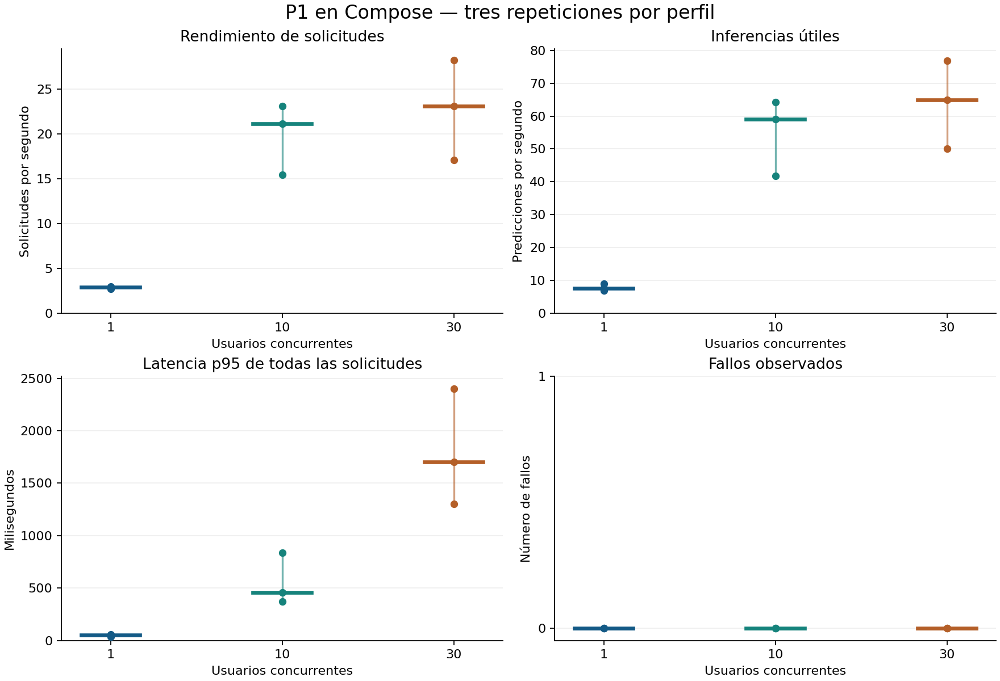
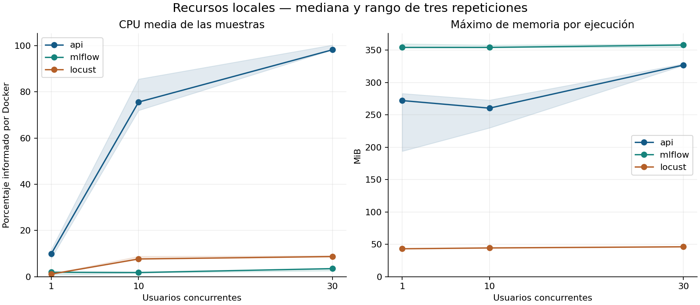
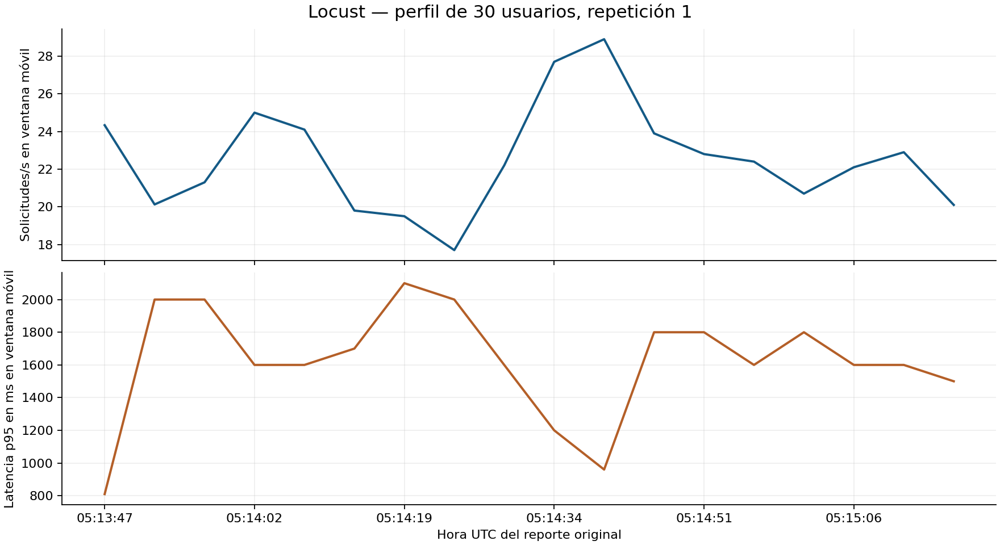

# Estado de la Etapa 6

La implementación del [PR #72](https://github.com/makroem/TC5061-Proyecto-Equipo39/pull/72) está integrada en `main` desde el 19 de noviembre de 2026 mediante `7c49a81`. Diego Hurtado [aprobó el último cambio `a9d8424`](https://github.com/makroem/TC5061-Proyecto-Equipo39/pull/72#pullrequestreview-5969054034). El [cierre de revisión](cierre_revision_20261119.md) conserva las fechas, la procedencia de los resultados y el alcance de esa aprobación.

## Avance verificado

- 108 pruebas de API y operación aprobadas localmente. Este conteo corresponde a `tests/api` y `tests/operations`, no al total histórico del proyecto.
- API y tracking saludables con Compose; P1 responde en lotes de 1, 10 y 100 y rechaza el lote vacío con 422.
- [Persistencia comprobada](../../references/etapa6/checks/persistence.json) al recrear los contenedores; el volumen conserva el experimento de verificación.
- El flujo ejecuta pruebas en Linux y Windows, construcción y despliegue temporal. Consultar los [controles del PR aprobado](https://github.com/makroem/TC5061-Proyecto-Equipo39/pull/72/checks) y la [ejecución sobre main integrado](https://github.com/makroem/TC5061-Proyecto-Equipo39/actions/runs/44553281639).
- Nueve mediciones exploratorias de P1: 13,001 solicitudes, 36,176 predicciones útiles y cero fallos de solicitud. Los objetivos de latencia no se cumplen en los perfiles de 10 y 30 usuarios.
- Nueve registros de métricas creados en el tracking operativo; [identificadores y huella de la tabla](../../references/etapa6/mediciones_marco/tracking_runs.json).
- [Seguridad interpretada](seguridad_operacion.md): 9 avisos bajos documentados, 0 medios y 0 altos.

## Informe final para entrega

El [informe final de Operación y FinOps](../../references/etapa6/TC5061_Operacion_FinOps_Equipo39_Final.docx), con corte al 21 de noviembre de 2026, conserva cuatro páginas de análisis y cinco de anexos, con Arial 11 e interlineado 1.15. Incluye las gráficas de Locust y recursos (anexos A–C), las nueve mediciones originales (anexo D), el análisis FinOps y el costo por inferencia (p. 3), y la captura del [pipeline exitoso de main sobre `1359830`](https://github.com/makroem/TC5061-Proyecto-Equipo39/actions/runs/44981895636) (anexo E). Su SHA-256 es `7c7f3f99f3512bdf382d7c341fef83dca5ea29fd5e242eff4a2b0ac0a6dfba9e`.

El [PR #77](https://github.com/makroem/TC5061-Proyecto-Equipo39/pull/77) fue aprobado por Diego Hurtado e integrado por Marco el 21 de noviembre a las 21:43, hora de Ciudad de México, mediante `1359830`. GitHub vincula la [aprobación](https://github.com/makroem/TC5061-Proyecto-Equipo39/pull/77#pullrequestreview-6010082736) a `d4eff36`, aunque el texto del revisor menciona `4dfd34d`; se conserva esa distinción. La ejecución posterior completó los tres trabajos de pruebas en Linux y Windows, construcción y despliegue temporal. Los tres avisos de migración de Node.js no impidieron el resultado exitoso. La [tarea #73](https://github.com/makroem/TC5061-Proyecto-Equipo39/issues/73) está cerrada.

Diego Hurtado [aprobó el PR #78](https://github.com/makroem/TC5061-Proyecto-Equipo39/pull/78#pullrequestreview-6013294045) sobre `734c7f5`. Marco lo integró el 22 de noviembre de 2026 a las 10:51, hora de Ciudad de México, mediante `19a0e0a`. La [ejecución posterior de main](https://github.com/makroem/TC5061-Proyecto-Equipo39/actions/runs/45046142850) aprobó sus tres trabajos, con 108 pruebas por sistema operativo. El [PDF para entrega](../../references/etapa6/TC5061_Operacion_FinOps_Equipo39.pdf) reproduce el Word aprobado; se conserva el corte del informe y su captura histórica de #77. Las gráficas, los cálculos y los incumplimientos de latencia originales permanecen intactos. La incorporación del PDF y de este seguimiento tiene su propia revisión documental.

Se conserva la [versión actualizada incorporada mediante #77](../../references/etapa6/TC5061_Operacion_FinOps_Equipo39_Actualizado.docx), con SHA-256 `296afaa611d9f806ba37b5906b36b137452ffb12fba06ca90a08d382b0644bd5`. Sus referencias a revisión pendiente reflejan el corte previo a la integración.

### Informe anterior aprobado y conservado

El [informe de operación y FinOps](../../references/etapa6/TC5061_Microservicios_FinOps_Equipo39.docx) contiene cuatro cuartillas de análisis y cuatro páginas de anexos, con Arial 11, texto justificado e interlineado 1.15. Incluye las tres gráficas originales, resultados de las nueve ejecuciones, cálculo por inferencia útil, sensibilidad y recomendaciones. Se verificaron cifras, enlaces y paginación; el [registro de comprobación](../../references/etapa6/checks/reporte_revision.json) identifica su versión.

El informe de Marco fue contrastado por Diego Hurtado, quien confirmó su huella, tres imágenes y contenido en la aprobación del PR #72. Se conserva exactamente el archivo revisado: las menciones a tareas pendientes dentro del documento describen su corte del 18 de noviembre. El [cierre del 19 de noviembre](cierre_revision_20261119.md) actualiza el estado sin sustituir sus mediciones ni atribuir una prueba nueva a Marco.

## Resultados de carga

Cada perfil tiene tres repeticiones. Las tasas usan la duración real desde el inicio hasta el cierre, incluido el drenaje final; el tiempo configurado es de 90 segundos. La mediana del p95 se calcula entre ejecuciones y no equivale al p95 de todas las solicitudes combinadas.

| Usuarios | Solicitudes/s mediana | Inferencias/s mediana | p95 mediana y rango ms | Objetivo de latencia |
|---:|---:|---:|---|---|
| 1 | 2.91 | 7.61 | 51 (39 a 59) | Cumple |
| 10 | 21.16 | 59.08 | 460 (370 a 840) | No cumple |
| 30 | 23.12 | 64.94 | 1700 (1300 a 2400) | No cumple |

La API se aproxima al límite de 1 CPU al aumentar la concurrencia. Pasar de 10 a 30 usuarios incrementa poco la mediana del rendimiento y eleva claramente la latencia. Esto es compatible con saturación del servicio, pero el ensayo no aísla todos los efectos del anfitrión. El generador comparte el motor local; durante el ensayo también se realizaron comprobaciones auxiliares y revisión documental en el equipo. Por ello, los resultados son exploratorios y deben contrastarse en una ejecución independiente con el equipo dedicado a la prueba.

La mezcla de peticiones es sintética y representa consultas individuales y planeación por lotes. No estima la distribución real de tráfico. Los objetivos de 250 ms en nominal y 1000 ms en pico fueron propuestos antes del ensayo; son metas de operación del equipo, no umbrales de la rúbrica. Se evalúan también por separado los lotes de 1 y de 10 en [performance.csv](../../references/etapa6/mediciones_marco/performance.csv).

Los puntos y líneas resumen tres ejecuciones; las bandas muestran mínimo y máximo. La CPU es la informada por Docker; la memoria corresponde al máximo muestreado por ejecución. El intervalo real entre muestras incluye el tiempo de consulta de docker stats, por lo que no se presenta como una medición continua exacta.

La serie anterior proviene del [HTML original del perfil de 30 usuarios](../../references/etapa6/mediciones_marco/locust/u30_r1.html). Sus ventanas móviles difieren de los promedios globales. Se conservan tres HTML originales y los datos finales de las nueve ejecuciones en [locust](../../references/etapa6/mediciones_marco/locust/).

En dos registros originales, u10_r3 y u30_r3, Locust emitió un aviso de escritura sobre CSV cerrado al finalizar. No se omiten esas ejecuciones: los totales finales del HTML y del resumen coinciden y las solicitudes no fallaron. El análisis usa esos resultados finales. El programa se ajustó para generar el CSV después de terminar Locust, a partir del HTML completo, evitando el escritor periódico concurrente. La [comprobación de esa exportación](../../references/etapa6/checks/export_check.json) se conserva separada de las nueve mediciones; no reemplaza ni altera sus valores.

## Estimación FinOps

Referencia: [AWS Lightsail Linux con IPv4](https://aws.amazon.com/lightsail/pricing/), 24 USD/mes, 2 vCPU, 4 GB, 80 GB SSD y 4 TB de transferencia incluida; consultada el 17 de noviembre de 2026. Se utiliza la máquina completa para API y tracking y una convención de 730 horas por mes. El generador de pruebas no se considera un servicio permanente de producción.

Costo del intervalo = 24 × duración / (730 × 3600). Costo por inferencia = costo del intervalo / predicciones útiles. El factor de utilización representa el uso efectivo de la capacidad observada; no se sustituye por el porcentaje de CPU. Las solicitudes fallidas consumirían tiempo, pero no aumentarían el denominador de predicciones útiles.

| Perfil observado | USD por 1000 inferencias con 10% de uso | Con 50% | Con 100% |
|---|---:|---:|---:|
| 1 usuario | 0.011996 | 0.002399 | 0.001200 |
| 10 usuarios | 0.001546 | 0.000309 | 0.000155 |
| 30 usuarios | 0.001406 | 0.000281 | 0.000141 |

Son medianas de estimaciones por ejecución. Los costos menores bajo mayor carga no justifican aceptar latencias que incumplen los objetivos. El perfil de un usuario es el único que cumplió las metas en estas mediciones. No se presupone que el rendimiento local se mantendrá en la nube ni durante todo un mes.

La [sensibilidad completa](../../references/etapa6/mediciones_marco/finops_sensitivity.csv) incluye tarifas de 12, 24 y 44 USD y utilización de 10, 50 y 100 por ciento, manteniendo rendimiento constante únicamente para aislar el efecto aritmético de cada supuesto. Los planes comparados tienen distintas memorias; el de mayor RAM no implica automáticamente más CPU útil ni menor latencia. Se excluyen impuestos, soporte, respaldos y transferencia excedente. Los límites de ráfaga y la capacidad del equipo de destino deben validarse antes de usar la estimación como presupuesto.

Prioridades de mejora: repetir en un anfitrión dedicado y con generador separado; medir el efecto de la cuota de CPU y de los procesos de inferencia; mantener los lotes cuando su tiempo de respuesta sea admisible; comprobar margen de memoria antes de reducir el plan; apagar entornos de prueba fuera de uso. Cada cambio debe conservar modelo, entradas y protocolo para permitir comparación. No se atribuye ahorro medido a una optimización todavía no probada.

## Seguimiento por persona

| Responsable | Avance y siguiente actividad | Dependencia y respaldo |
|---|---|---|
| [Marco #73](https://github.com/makroem/TC5061-Proyecto-Equipo39/issues/73) | PR #72, #77 y #78 integrados; tarea #73 cerrada. Informe editable aprobado, PDF e inventario de archivos preparados. | La incorporación del PDF y el seguimiento requieren revisión del nuevo PR documental; las mejoras de rendimiento se siguen por separado. |
| [Diego Hurtado #74](https://github.com/makroem/TC5061-Proyecto-Equipo39/issues/74) | Aprobaciones de #72, #77 y #78 realizadas. Conservar y entregar, si están disponibles, los originales de su ensayo. | Los archivos de carga faltantes impiden cuantificar diferencias entre equipos; no bloquean el cierre documental ya aprobado. |
| [Stefania #75](https://github.com/makroem/TC5061-Proyecto-Equipo39/issues/75) | Aportación presentada en el [PR #79](https://github.com/makroem/TC5061-Proyecto-Equipo39/pull/79), todavía sin integrar. | Requiere revisión; la comparación favorable de 10 frente a 30 usuarios no implica cumplir el objetivo de 250 ms. El respaldo técnico ya está integrado. |
| [Diego Martínez #76](https://github.com/makroem/TC5061-Proyecto-Equipo39/issues/76) | [PR #80](https://github.com/makroem/TC5061-Proyecto-Equipo39/pull/80) aprobado por Marco e integrado el 22 de noviembre mediante `4c37247`; tarea #76 cerrada. | Seis controles previos correctos. Su [revisión](revision_verificaciones_diego_martinez.md) distingue la fixture de CI de P1 y conserva el alcance de las comprobaciones. |

El contenido de respaldo se atribuye a Marco. No se registra como participación de Stefania o Diego Martínez ni sustituye sus aportaciones individuales. El manual conserva la distribución inicial; este seguimiento registra el estado posterior a la revisión.

Las nueve mediciones corresponden al cambio `41a4d421df2bde3fd07679d3642aa3cc23aa8c14`; su protocolo registra las huellas de código e imagen. Las correcciones posteriores afectan comprobaciones HTTP, exportación y documentación, sin modificar el modelo ni la implementación de la API.
