# Reporte de experimentos MLflow del Equipo 39

## Versión corregida de la segunda entrega

2 de noviembre de 2026

Este reporte integra las tablas y las capturas oficiales que faltaban en la versión entregada. P1 conserva la media histórica, P2 la regresión logística con C=0.1 y P3 la mezcla gaussiana de tres componentes. Los tres modelos cuentan con evidencia de registro y carga por el alias champion. La ampliación analiza su costo y estabilidad sin cambiar las selecciones ni las métricas históricas.

La actualización de código elimina la captura manual de identificadores entre reproducción y registro. El archivo de selección ya está versionado. Se distingue la evidencia oficial de octubre de la comprobación del flujo actual en un almacén independiente.

Equipo del proyecto: Marco, Stefania, Diego Martinez y Diego Hurtado. Implementación y consolidación de esta corrección: Marco. Revisión independiente de la corrección: Diego Hurtado, mediante Pull Request. Las contribuciones históricas se conservan; no se atribuye a otros integrantes la ejecución de esta actualización.

La versión anterior se conserva como antecedente de la entrega. Este documento no acredita por sí mismo su reenvío ni la aceptación de una corrección por el docente.

## Enlace al repositorio
https://github.com/makroem/TC5061-Proyecto-Equipo39

Las tablas fuente están en reports/etapa2/p1_comparacion_oficial.csv, p2_comparacion_oficial.csv y p3_comparacion_oficial.csv. El índice capturas_mlflow_marco.md relaciona las imágenes oficiales con sus corridas y describe los recortes.

## Datos y alcance de la comparación

Se conservan doce meses, de octubre de 2025 a septiembre de 2026, con 4,497,119 viajes válidos. La malla de características tiene 4,108,440 filas y 469 estaciones. La partición cronológica usa 243 días de entrenamiento, 61 de validación y 61 de prueba. La semilla es 39. Cada búsqueda oficial contiene un baseline y tres candidatas comparables en el mismo experimento mibici-equipo39.

<!--page-->

## Comandos de reproducción

Antes de instalar, comprobar git --version y python --version. El proyecto requiere Python 3.11.9. Los comandos siguientes son para PowerShell y deben ejecutarse desde el commit revisado que contiene el punto de entrada reproduce.

```powershell
git clone https://github.com/makroem/TC5061-Proyecto-Equipo39.git
cd TC5061-Proyecto-Equipo39
python -m venv .venv
.\.venv\Scripts\python.exe -m pip install -r requirements.txt
.\.venv\Scripts\python.exe -m pip install --no-deps -e .
$env:Path = (Resolve-Path .venv\Scripts).Path + ';' + $env:Path
python -m pip check
```

Las versiones actuales incluyen MLflow 3.17.2 y PyArrow 23.0.1. La migración ya realizada se conserva. Las tablas y capturas oficiales pertenecen al entorno histórico; una nueva ejecución genera identificadores y tiempos propios.

Para validar sin escribir en el servidor oficial, configurar una base independiente. MLflow Projects permite encadenar puntos de entrada y conservar el identificador de cada ejecución (MLflow, s. f.-b).

```powershell
New-Item -ItemType Directory -Force private_tracking | Out-Null
$env:MLFLOW_TRACKING_URI = 'sqlite:///private_tracking/reproduccion.db'
$env:MLFLOW_REGISTRY_URI = $env:MLFLOW_TRACKING_URI
mlflow run . -e reproduce --env-manager local `
  --experiment-name mibici-equipo39 -P member=Marco
if ($LASTEXITCODE -ne 0) { throw 'Revisar el error de reproducción.' }
```

El flujo valida las selecciones, ejecuta la ingesta y las características, reproduce las tres preguntas y registra las hijas exactas que acaba de generar. Finalmente carga los tres modelos por alias. No solicita run_id ni busca la corrida más reciente del servidor.

El resumen se guarda como private_results/stage2/workflow_<identificador>.json y como evaluation/reproduction.json en MLflow. Para consultar la interfaz de este almacén:

```powershell
mlflow ui --backend-store-uri sqlite:///private_tracking/reproduccion.db --port 5002
```

<!--page-->

## Selección versionada y límites de reproducción

references/etapa2/selection.json ya contiene las selecciones aprobadas, la versión de datos, la partición y los umbrales de P2. Se consume automáticamente; no debe prepararse ni aprobarse otra vez para reproducir el mismo resultado. La validación rechaza una selección incompatible con los manifiestos o el plan de modelos. P2 conserva 0.65 para bicicletas y 0.70 para anclajes; no se recalibran con prueba.

Una selección futura diferente requiere una decisión y un cambio versionado propios. Esto separa la revisión de una nueva decisión de la ejecución automática de una selección existente.

Si un entrenamiento falla, el flujo se detiene antes de registrar modelos. El registro comprueba trazabilidad y carga antes de asignar cada alias. La actualización de los tres alias es secuencial, por lo que un fallo durante registro puede dejar una parte completada en el almacén elegido. La comprobación debe realizarse en una base independiente y finalizar con verify_registry.

### Disponibilidad de las fuentes

El intento del 2 de noviembre de 2026 desde un clon sin datos se detuvo por HTTP 404 al descargar nomenclatura_2026_09.csv. El enlace con www que publica el portal tampoco entregó el CSV con el cliente de ingesta. No se cambiaron las fuentes, los hashes ni el periodo para ocultar esta limitación.

La validación adicional usa las trece copias históricas conservadas por Marco, verificadas contra el manifiesto. Esa prueba acredita el flujo con fuentes disponibles en caché, pero no acredita una descarga nueva completa desde cualquier máquina. La disponibilidad de las fuentes es una dependencia externa distinta del paso manual de registro que se corrige aquí. Los CSV, las bases de MLflow y los modelos permanecen fuera de GitHub.

### Trazabilidad histórica

Commit de las búsquedas oficiales:
97f0033d1669bea64f38d86cf78f680dffbd3062

Commit de reproducción y registro oficiales:
288a592aba240983c8d21c8128c16be4cbf0f2df

Versión de datos:
e9de13df5e9bdc1fde98c042f700e1a7c568ad85df5a303a96a78b3d4d45dbb7

Partición:
ab6301f96f083217512343b4f800bc5ddea51b666492ef05b34da85591cc9bdd

<!--page-->

## Tabla comparativa P1 contra el baseline

P1 estima salidas por estación en la siguiente hora para apoyar la planeación de flota. La métrica principal es MAE; un valor menor indica menor error. La mejora se expresa como MAE baseline menos MAE candidato. El RMSE complementa la lectura de errores grandes (scikit-learn developers, s. f.).

| Variante | Validación | Prueba | Mejora val |
| --- | --- | --- | --- |
| baseline | 0.888775 | 0.916381 | +0.000000 |
| p1_hgb_100 | 0.985315 | 0.997964 | -0.096540 |
| p1_hgb_200 | 0.909733 | 0.931749 | -0.020957 |
| p1_rf_300 | 0.919891 | 0.935562 | -0.031116 |

| Variante | Hiperparámetros clave |
| --- | --- |
| baseline | Media de train por estación, día de semana y hora; respaldo para grupos no observados |
| p1_hgb_100 | Poisson; 100 iteraciones; learning_rate 0.1; 31 hojas |
| p1_hgb_200 | Poisson; 200 iteraciones; learning_rate 0.05; 31 hojas |
| p1_rf_300 | 300 árboles; profundidad 16; hoja mínima 20; muestra 0.5; n_jobs 2 |

Todas las variantes aleatorias usan random_state=39. Los parámetros completos se conservan en el CSV oficial y en los artefactos de configuración. Los tres candidatos deterioran el MAE de validación. Por eso la selección final de P1 es el baseline, no un candidato más complejo.

<!--page-->

## Análisis y justificación de P1

### Costo computacional

| Modelo | Ajuste s | Inferencia val ms/1000 | Tamaño MB |
|---|---:|---:|---:|
| Baseline | 3.53 | 1.63 | 1.12 |
| HGB 100 | 37.53 | 7.55 | 1.51 |
| HGB 200 | 63.96 | 13.86 | 1.86 |
| Random Forest 300 | 1268.95 | 28.00 | 425.64 |

El bosque tarda 21.15 minutos frente a 3.53 segundos del baseline y ocupa unas 379 veces más espacio, sin mejorar MAE. Son mediciones históricas de una ejecución, no un benchmark repetido ni un costo monetario.

### Estabilidad y límites

| Modelo | MAE junio 2026 | MAE julio 2026 |
|---|---:|---:|
| Baseline | 0.912257 | 0.866051 |
| HGB 100 | 0.983585 | 0.986989 |
| HGB 200 | 0.917862 | 0.901865 |
| Random Forest 300 | 0.916464 | 0.923207 |

El baseline gana en ambos meses de validación y su rango mensual es 0.046207. HGB 100 varía menos entre meses, pero su error es mayor en ambos; además, su RMSE de validación es 7.667411 frente a 1.696415 del baseline. Menor variación no equivale a mejor desempeño.

El MAE del baseline sube 3.11% entre validación y prueba. Dos meses y una semilla no prueban estabilidad futura. Se requieren más ventanas temporales; reproducibilidad no equivale a robustez. No se ajustó la selección con prueba. El análisis completo y los extractos por mes y hora están en p1.md.

<!--page-->

## Tabla comparativa P2 contra el baseline

P2 estima dos riesgos en la siguiente hora: falta de bicicletas y de anclajes. MiBici no publica inventario observado; las etiquetas suponen ocupación inicial de 50% y comparan el flujo acumulado con 10% y 90% de la capacidad. El modelo usa calendario y estación, sin incorporar el flujo futuro como predictor.

La métrica macro_f1 del proyecto es el promedio del F1 de la clase positiva de ambos riesgos. La mejora de validación es F1 candidato menos F1 baseline. No se calcula mejora porcentual porque la referencia es cero.

| Variante | Validación | Prueba | Mejora val |
| --- | --- | --- | --- |
| baseline | 0.000000 | 0.000000 | +0.000000 |
| p2_lr_0.1 | 0.042360 | 0.052181 | +0.042360 |
| p2_lr_1 | 0.042048 | 0.051779 | +0.042048 |
| p2_lr_10 | 0.041985 | 0.051701 | +0.041985 |

| Variante | Configuración | Ajuste s |
| --- | --- | --- |
| baseline | Dos Dummy prior | 2.93 |
| p2_lr_0.1 | Dos logísticas C=0.1 | 74.00 |
| p2_lr_1 | Dos logísticas C=1.0 | 88.39 |
| p2_lr_10 | Dos logísticas C=10.0 | 99.76 |

Las logísticas usan class_weight=balanced, solver=liblinear, max_iter=1000 y random_state=39. La calibración usa validación: recall mínimo 0.80 y máxima precisión; si ninguna opción lo alcanza se usa el mayor F1. La elegida es C=0.1, con umbrales 0.65 para bicicletas y 0.70 para anclajes. La decisión se congeló antes de evaluar prueba.

<!--page-->

## Análisis y justificación de P2

C=0.1 obtiene el mayor F1 de validación y requiere 74.00 segundos, frente a 88.39 y 99.76 de C=1 y C=10. Son ahorros aproximados de 16.3% y 25.8% en esa ejecución, respectivamente. El baseline cuesta 2.93 segundos, pero no detecta positivos y su F1 es cero. La mejora absoluta de C=0.1 es 0.042360; una mejora porcentual sobre cero no está definida.

La diferencia de F1 entre C=0.1 y C=1 es solo 0.000312. Las tres logísticas tienen un comportamiento parecido y una única ejecución no demuestra que el orden sea estadísticamente estable. La elección por validación es consistente con el menor tiempo observado entre las candidatas, pero no debe presentarse como una superioridad amplia. El CSV oficial de P2 no incluye tamaño ni latencia; no se extrapolan los valores de P1 ni se inventa un costo monetario.

En prueba se producen 169.97 alertas de bicicletas y 139.54 de anclajes por cada mil estación-horas, con precisión 2.19% y 3.21%. Cerca del 97.81% y 96.79% de las alertas, respectivamente, son falsos positivos respecto del proxy, no respecto de un inventario observado. Enviar un vehículo por cada alerta sería difícil de justificar. El resultado puede apoyar una priorización revisada por el operador, con validación de inventario antes de intervenir. Los dos riesgos pueden coincidir en una hora y sus cargas no se suman como si fueran órdenes de trabajo distintas.

El recall de anclajes cae de 0.8076 en validación a 0.7898 en prueba y deja de cumplir el objetivo de 0.80. Con inventario inicial supuesto de 25%, el recall de bicicletas en prueba baja a 0.5742; con 75%, el de anclajes cae a 0.4715. La sensibilidad se calculó con el modelo y los umbrales fijos: muestra dependencia de la etiqueta respecto del supuesto, no nuevos modelos optimizados. Se requiere inventario observado y validación temporal adicional antes de uso operativo.

| Prueba con modelo fijo | Recall bicicletas | Recall anclajes |
| --- | --- | --- |
| Ocupación inicial 25% | 0.5742 | 0.9387 |
| Ocupación inicial 50% | 0.8495 | 0.7898 |
| Ocupación inicial 75% | 0.9516 | 0.4715 |

Fuente de sensibilidad: reproducción oficial 73804085f3944b54ac2f99542eec38be, artefacto evaluation/summary.json. El extracto p2_sensibilidad_oficial.json conserva su URI y hash. No representa observaciones de inventario real.

<!--page-->

## Tabla comparativa P3 contra el baseline

P3 agrupa estaciones por perfiles de 48 variables: 24 horas laborales y 24 de fin de semana. Se usa StandardScaler ajustado solo en train. Las coordenadas se reservan para interpretar los grupos. Se maximiza silhouette de validación entre variantes elegibles; la elegibilidad exige al menos 5% de estaciones en cada grupo de entrenamiento.

| Variante | Validación | Prueba | Mejora val |
| --- | --- | --- | --- |
| p3_kmeans_3 | 0.005564 | 0.079255 | +0.000000 |
| p3_kmeans_4 | -0.019898 | 0.028182 | -0.025461 |
| p3_kmeans_5 | -0.043167 | 0.027266 | -0.048731 |
| p3_gmm_3 | 0.026594 | 0.051373 | +0.021030 |

KMeans usa k=3, 4 o 5, n_init=20 y semilla 39. GMM usa tres componentes, covarianza diagonal, n_init=5, max_iter=300 y reg_covar=0.000001. El escalador y el estimador se guardan juntos.

### Análisis y justificación de P3

GMM 3 obtiene silhouette de validación 0.026594 y cumple el grupo mínimo con 25 estaciones, 6.78%. El baseline KMeans 3 alcanza 4.88% en entrenamiento y no cumple la elegibilidad. No se cambia la selección al observar prueba: GMM registra 0.051373 frente a 0.079255 del baseline.

La estabilidad ARI media de GMM es 0.491616, con mínimo 0.273269, frente a 0.856475 del baseline. El grupo mínimo de prueba cae a 4.61%. Estas cifras limitan la estabilidad y la separación del agrupamiento; sirve para exploración, no para decidir una expansión sin análisis territorial.

El ajuste total de GMM tarda 9.11 segundos, incluye el trabajo de estabilidad del adaptador y no equivale solo a pipeline.fit. La inferencia de validación tarda 5.15 ms por mil perfiles y el modelo ocupa 7,893 bytes. El costo es pequeño en esta población; la debilidad principal es la calidad y estabilidad de la agrupación. Los parámetros restantes son max_iter=300, reg_covar=0.000001 y random_state=39.

<!--page-->

## Esquema de ciclo de vida justificado

Cada modelo tiene un nombre estable y versiones con descripción, corrida de origen, commit y versión de datos. El alias champion identifica la selección académica que puede cargarse por nombre; evita que el consumidor dependa de un número de versión fijo. MLflow documenta estos alias y el linaje como mecanismos del Model Registry (MLflow, s. f.-a).

El orden aplicado es comparar con validación, justificar la selección, revisar la configuración, reproducirla, comprobar firma y predicción al recargar, registrar y asignar champion. La verificación independiente del 27 de octubre terminó correctamente para las tres versiones. Champion no significa un servicio de producción desplegado ni utilidad operativa demostrada.

### P1

Modelo: mibici-equipo39-p1-demanda

Versión oficial: 1. Alias: champion. Carga: ok.

Corrida de origen: 66414a8b45164d3a8f5b9f42e7cb387b

URI de consumo: models:/mibici-equipo39-p1-demanda@champion

### P2

Modelo: mibici-equipo39-p2-riesgo

Versión oficial: 1. Alias: champion. Carga: ok.

Corrida de origen: 73804085f3944b54ac2f99542eec38be

URI de consumo: models:/mibici-equipo39-p2-riesgo@champion

### P3

Modelo: mibici-equipo39-p3-grupos

Versión oficial: 1. Alias: champion. Carga: ok.

Corrida de origen: fb847f28e5484ff885e8ef9b44afb2d7

URI de consumo: models:/mibici-equipo39-p3-grupos@champion

Una actualización futura conserva las versiones anteriores para permitir volver a ellas. La corrección documental no mueve los alias oficiales. El flujo nuevo se prueba en otra base; sus identificadores y versiones no se presentan como los originales.

<!--page-->

## Capturas del paso 10

Las figuras siguientes son imágenes oficiales del 28 de octubre de 2026, sin sustituir nombres, resultados ni etiquetas. El manifiesto reports/figures/etapa2/capturas_20261028/origen.json conserva dimensiones, recortes y hashes. Las búsquedas de cada pregunta muestran un padre y cuatro hijas; las reproducciones posteriores son ejecuciones diferentes.

Las capturas del registro corresponden a las reproducciones oficiales del 27 de octubre. El campo de etapas antiguas puede aparecer como None porque se usa champion. Las nuevas comprobaciones en un almacén independiente se documentan por separado y no sustituyen estas figuras.

### Figura 1

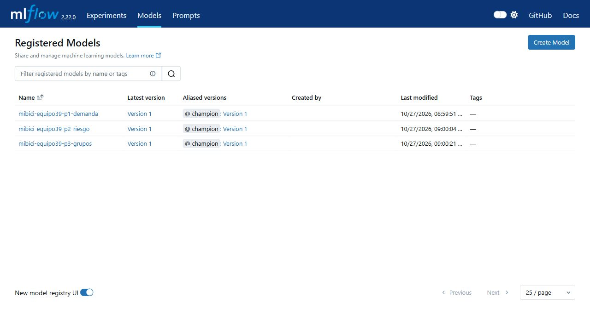

Registro oficial de los tres modelos con versión 1 y alias champion.

Fuente: captura oficial del equipo. Archivo 01_registry_tres_modelos.jpg.

<!--page-->

### Figura 2

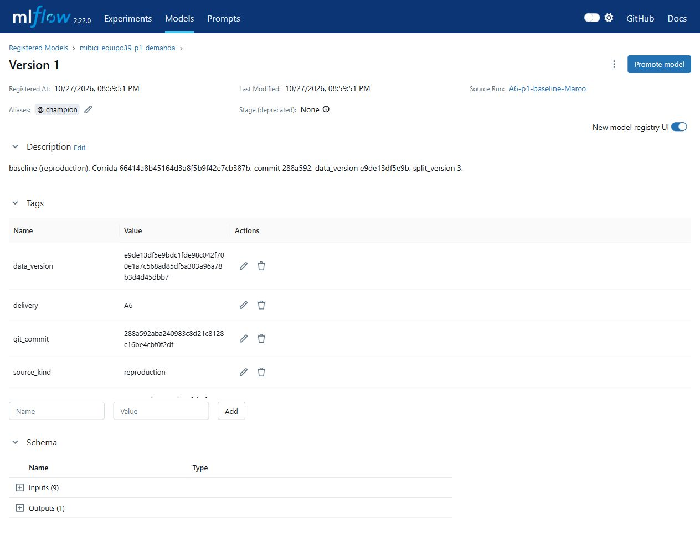

P1 registrada desde la reproducción 66414a8b45164d3a8f5b9f42e7cb387b. Se muestran alias y linaje.

Fuente: captura oficial del equipo. Archivo 02_p1_champion_linaje.jpg.

<!--page-->

### Figura 3

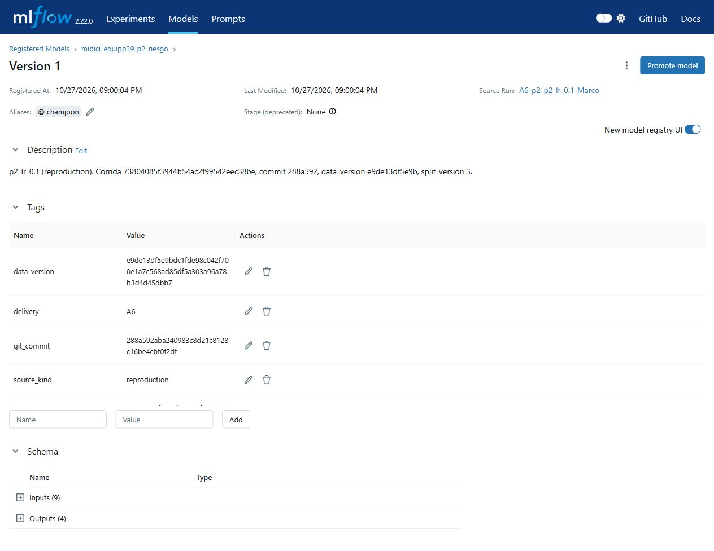

P2 registrada desde la reproducción 73804085f3944b54ac2f99542eec38be. Conserva la calibración aprobada.

Fuente: captura oficial del equipo. Archivo 03_p2_champion_linaje.jpg.

<!--page-->

### Figura 4

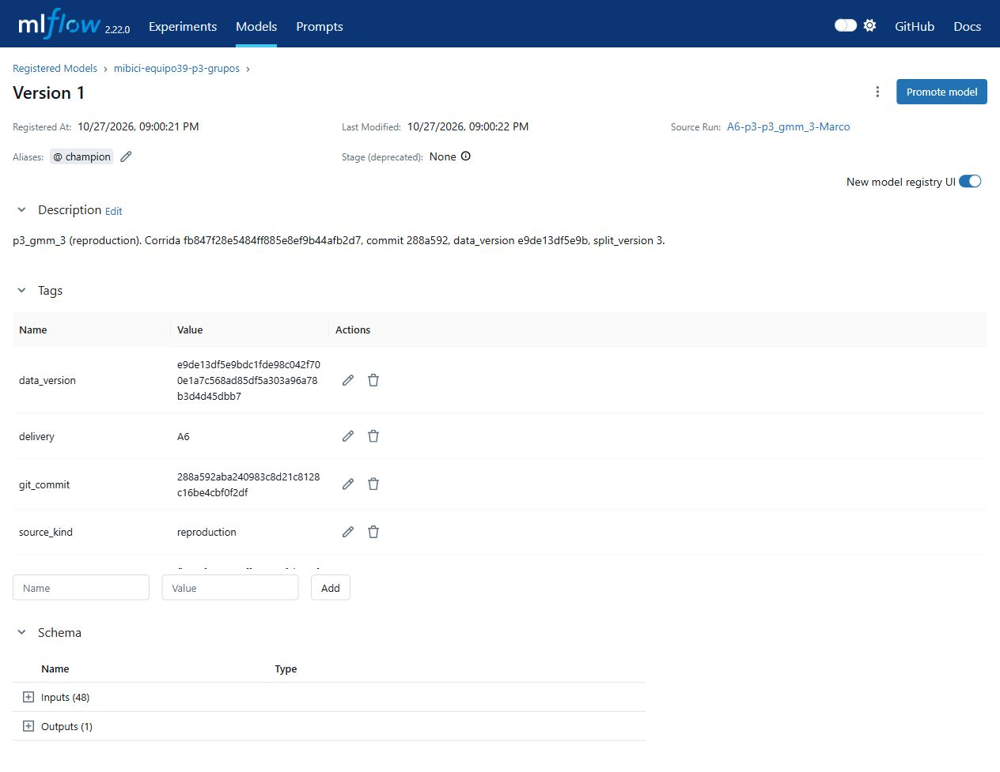

P3 registrada desde la reproducción fb847f28e5484ff885e8ef9b44afb2d7. Se muestran alias y linaje.

Fuente: captura oficial del equipo. Archivo 04_p3_champion_linaje.jpg.

<!--page-->

### Figura 5

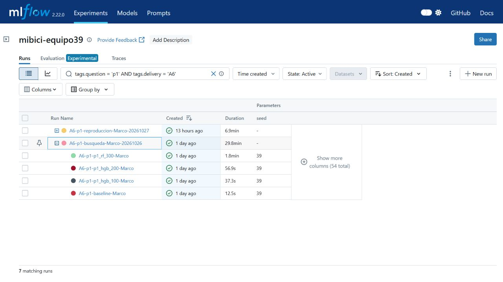

P1 búsqueda oficial anidada. Padre 310ec0be030047fc851669c8e91d863c; baseline y tres candidatas.

Fuente: captura oficial del equipo. Archivo 10_p1_corridas_anidadas.jpg.

<!--page-->

### Figura 6

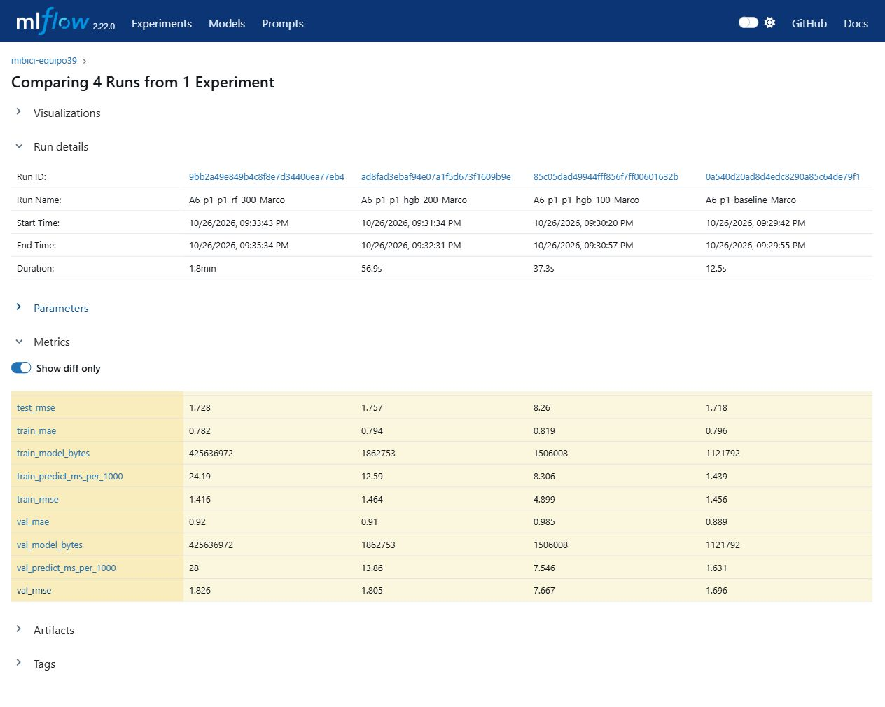

P1 comparación de validación y costos. Orden de columnas: RF 300, HGB 200, HGB 100 y baseline.

Fuente: captura oficial del equipo. Archivo 12_p1_comparacion_validacion.jpg.

<!--page-->

### Figura 7

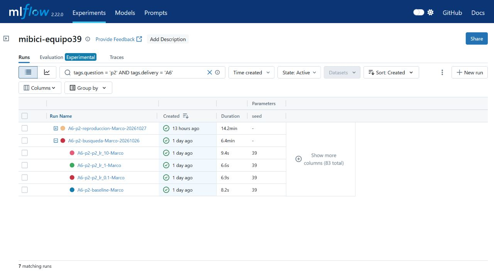

P2 búsqueda oficial anidada. Padre e0d9f693f211405ba3dcd80b357be4cb; baseline y tres candidatas.

Fuente: captura oficial del equipo. Archivo 13_p2_corridas_anidadas.jpg.

<!--page-->

### Figura 8

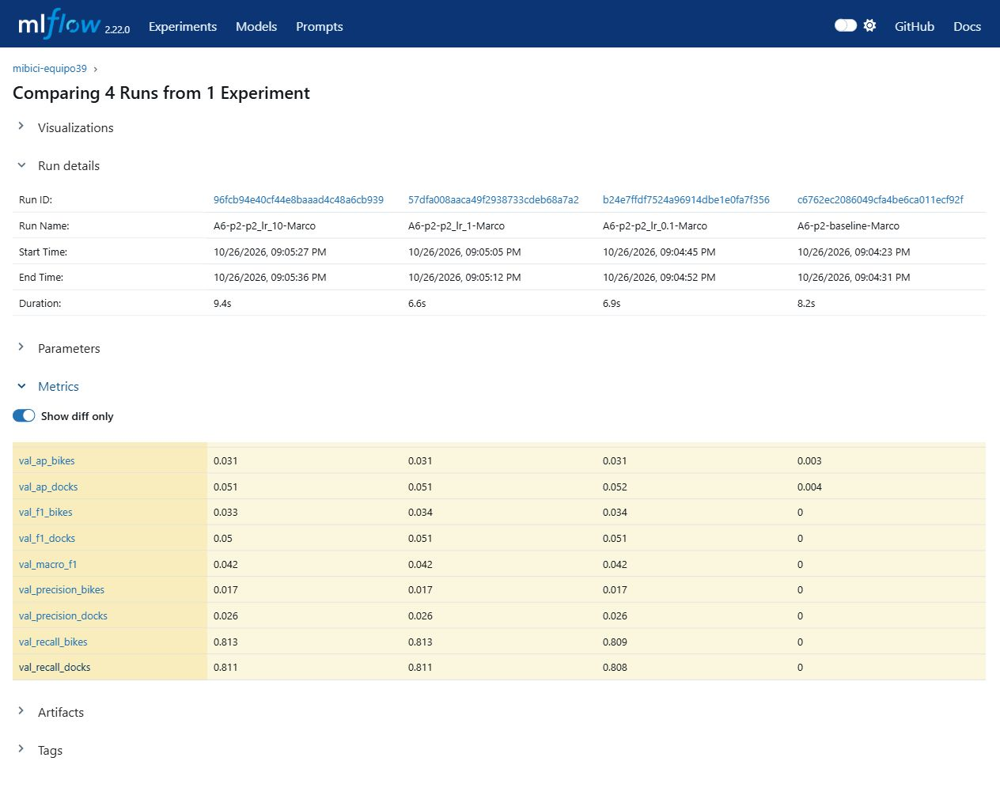

P2 comparación de F1, precisión, recall y AP. Orden: C=10, C=1, C=0.1 y baseline. El redondeo visual no implica empate.

Fuente: captura oficial del equipo. Archivo 15_p2_comparacion_validacion.jpg.

<!--page-->

### Figura 9


P3 búsqueda oficial anidada. Padre 09bfe57afcea4438b67aa7afc37ed56d; baseline y tres candidatas.

Fuente: captura oficial del equipo. Archivo 07_p3_corridas_anidadas.jpg.

<!--page-->

### Figura 10

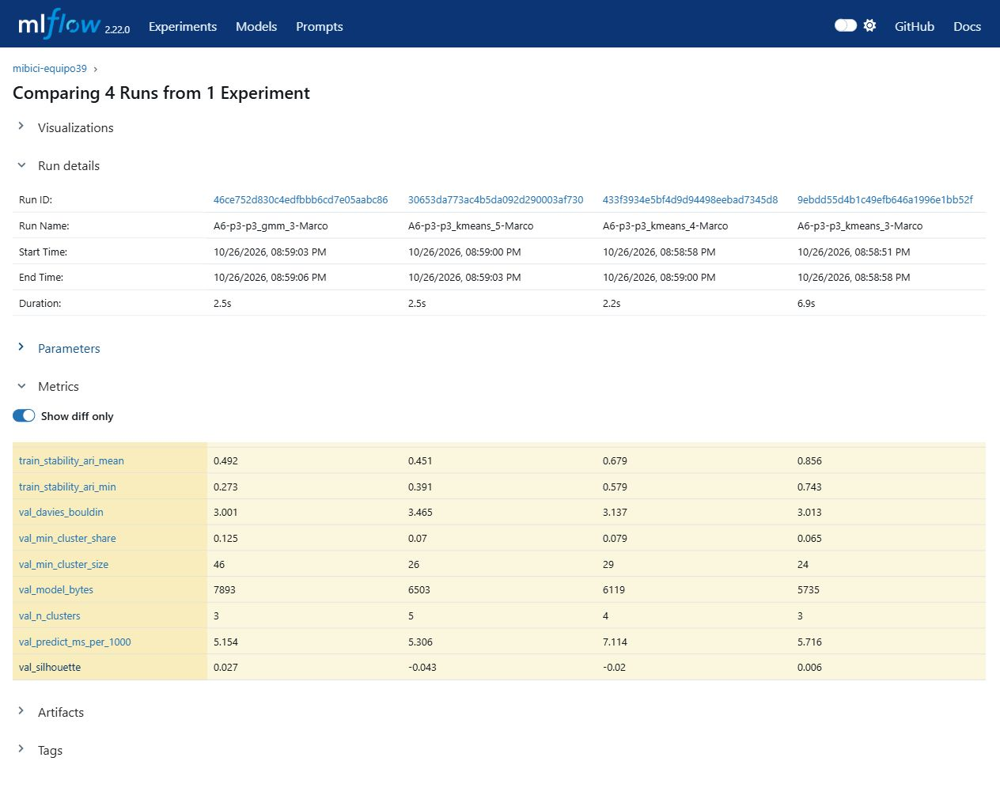

P3 comparación de validación y estabilidad. Orden: GMM 3, KMeans 5, KMeans 4 y KMeans 3 baseline.

Fuente: captura oficial del equipo. Archivo 09_p3_comparacion_validacion.jpg.

<!--page-->

### Figura 11

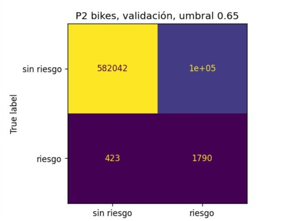

Matriz de confusión de validación de la candidata P2 C=0.1, umbral 0.65. El archivo es un recorte del panel de bicicletas; no muestra anclajes. La notación 1e+05 procede de la gráfica y no debe interpretarse como un conteo exacto de 100,000.

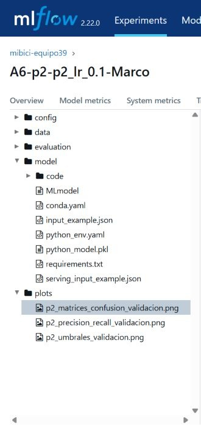

El recorte complementario identifica la corrida candidata b24e7ffdf7524a96914dbe1e0fa7f356 y el artefacto plots/p2_matrices_confusion_validacion.png. Ambos recortes conservan su contexto en el índice de capturas.

<!--page-->

## Validación de la corrección

La corrección incluye pruebas que rechazan versiones de datos o particiones incompatibles, parámetros modificados y calibración ausente; comprueban que el registro use la hija del padre exacto y que un fallo de entrenamiento detenga el flujo antes del registro. Pasaron 101 pruebas, con 0 fallos y 21 advertencias, en 579.56 segundos. El flujo del commit d3ddd10 terminó en el almacén independiente; las 68 métricas y conteos comparados coinciden con los oficiales con tolerancia relativa 1e-8 y absoluta 1e-10. La corrida del flujo es 1506890ec2ca4b2f9f8c9f853d7565f7. Los resultados y el límite de descarga por HTTP 404 se publican en validacion_correcciones_20261102.json y en la guía reproduccion.md.

Marco prepara el código, el reporte y las comprobaciones. Diego Hurtado debe contrastar las tablas, las figuras y la evidencia del nuevo flujo, y revisar el PR antes de su integración. Esta revisión no se presenta como realizada mientras no exista su aprobación en GitHub. La protección de main exige una revisión independiente; no se solicita participación adicional.

## Referencias en formato APA 7

Equipo 39. (2026a, 27 de octubre). Búsquedas oficiales de Marco y cierre técnico de la Etapa 2 [Resultados y código]. GitHub. https://github.com/makroem/TC5061-Proyecto-Equipo39/tree/main/reports/etapa2

Equipo 39. (2026b, 28 de octubre). Capturas de MLflow para la Etapa 2 [Capturas de pantalla]. GitHub. https://github.com/makroem/TC5061-Proyecto-Equipo39/blob/main/reports/etapa2/capturas_mlflow_marco.md

Mi Bici. (s. f.). Datos abiertos. Recuperado el 2 de noviembre de 2026, de https://www.mibici.net/es/datos-abiertos/

MLflow. (s. f.-a). MLflow Model Registry [Documentación]. Recuperado el 2 de noviembre de 2026, de https://mlflow.org/docs/latest/ml/model-registry/

MLflow. (s. f.-b). mlflow.projects [Documentación de la API]. Recuperado el 2 de noviembre de 2026, de https://mlflow.org/docs/latest/api_reference/python_api/mlflow.projects.html

scikit-learn developers. (s. f.). Metrics and scoring: Quantifying the quality of predictions [Documentación]. Recuperado el 2 de noviembre de 2026, de https://scikit-learn.org/stable/modules/model_evaluation.html
