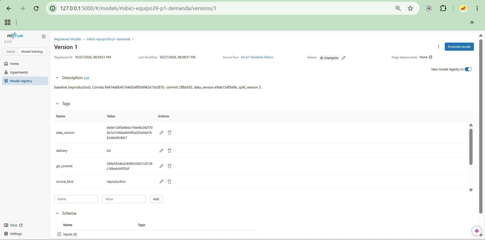

# E02 — Registry del modelo P1

Captura original proporcionada por Marco e incorporada el 2 de noviembre de 2026.

## Identificación y alcance

| Elemento | Evidencia visible |
|---|---|
| Servidor | `127.0.0.1:5000` |
| MLflow | `3.17.2` |
| Modelo | `mibici-equipo39-p1-demanda` |
| Versión | `1` |
| Alias | `champion` |
| Corrida de origen | `A6-p1-baseline-Marco` |
| Run ID | `66414a8b45164d3a8f5b9f42e7cb387b` |
| Commit de entrenamiento | `288a592aba240983c8d21c8128c16be4cbf0f2df` |
| Versión de datos | `e9de13df5e9bdc1fde98c042f700e1a7c568ad85df5a303a96a78b3d4d45dbb7` |

La imagen documenta la identidad y el linaje del modelo recuperado para la etapa 4. Estos identificadores coinciden con el [manifiesto del paquete](../../references/etapa4/model_manifest.json). La corrida conserva la etiqueta `source_kind=reproduction` y la entrega de origen `A6`; se reutiliza su versión registrada para preparar el servicio.

El campo `Stage (deprecated): None` corresponde al esquema de etapas antiguo. El equipo identifica la versión seleccionada mediante el alias `champion`.

## Integridad de la imagen

- Archivo: [E02_registry_p1.png](evidence/E02_registry_p1.png).
- Formato y dimensiones: PNG, 1917 × 947 píxeles.
- Tamaño: 132334 bytes.
- SHA-256: `78131e231ddb219b4bd6621d3cdca9bcc5adc3bc432817d734dbf5b89d683bce`.
- Procedencia: imagen adjunta por Marco; copia exacta, sin recortes, anotaciones ni cambios en su contenido.

Esta evidencia completa el pendiente de captura del Registry en el [arranque de Marco](arranque_marco.md). Las pruebas de la API HTTP y del contenedor se documentarán al integrar sus módulos.
