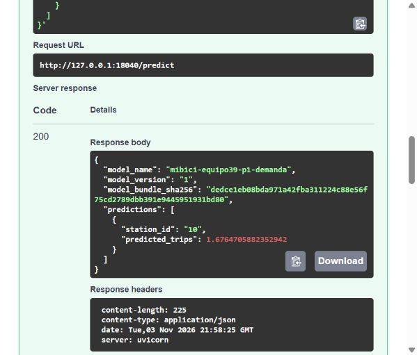
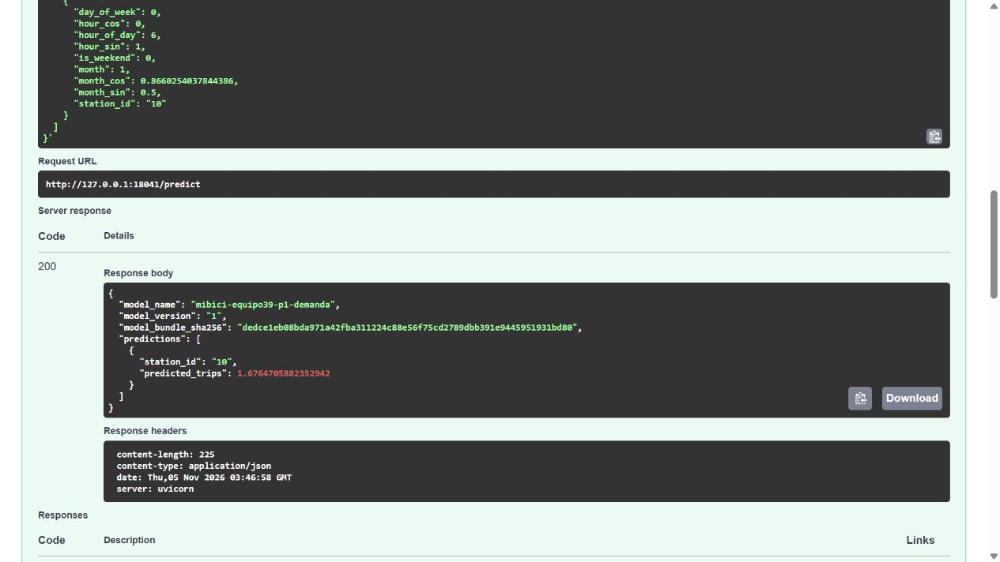

# Implementación y validación del servicio P1

Registro inicial: 3 de noviembre de 2026. Última actualización: 4 de noviembre de 2026, hora de Ciudad de México. Implementación y ejecución: Marco. Revisión independiente: Diego Hurtado, aprobada. El servicio ya está integrado en `main`; el cierre final se documenta al final de este registro.

## Cambio y continuidad

Marco completó esquemas Pydantic, conversión de tipos, API FastAPI, manejo de errores, pruebas y Containerfile. La implementación ya no espera módulos de Stefania o Diego Martinez. La [distribución vigente](../../references/etapa4/distribucion_actual.md) registra sus revisiones acotadas y las personas que pueden cubrirlas.

El servicio conserva el paquete aprobado de P1, versión 1 y run `66414a8b45164d3a8f5b9f42e7cb387b`. No se entrenó, recalibró ni modificó un alias. El hash del paquete es `dedce1eb08bda971a42fba311224c88e56f75cd2789dbb391e9445951931bd80`.

## Pruebas de código y servicio local

- Suite `tests/api`, aislada mediante `--confcutdir=tests/api`: **69 pruebas aprobadas**, 0 fallos, 1 advertencia, 2.45 s. Incluye 31 pruebas previas y 38 del contrato, adaptador y HTTP.
- `pip check`: sin dependencias incompatibles en el entorno de servicio Windows.
- Bandit del módulo de servicio: 1 aviso LOW B404 en la importación preexistente de subprocess del verificador independiente, 0 MEDIUM y 0 HIGH. Los módulos nuevos no añadieron hallazgos.
- Servicio Windows por HTTP en 18039: 72 casos, diferencia máxima 0.0 contra una carga independiente del paquete local; repetición idéntica y rechazo 422. [Resultado local](verificacion_http_marco_20261103.json).

El verificador HTTP se corrigió durante la preparación para no depender del generador de entradas del PR #45, que en ese momento estaba pendiente. La comprobación válida es la que terminó y produjo el JSON enlazado. Al probar Swagger se detectó que el ejemplo generado automáticamente no respetaba los campos cíclicos; se añadió un ejemplo válido y se comprobó mediante una prueba de OpenAPI. El contrato de errores documenta las respuestas reales, sin reflejar el cuerpo recibido.

La advertencia de Starlette indica la futura sustitución de httpx en TestClient. No afecta al resultado de esta suite. MLflow también advierte diferencias entre las dependencias históricas del modelo y el entorno reducido; no se modificó el archivo de dependencias incluido en el modelo para ocultarlas. La paridad comprobada cubre los casos indicados y no demuestra equivalencia para cualquier entrada ni exactitud predictiva frente a viajes reales.

## Comprobación en contenedor Linux

La construcción final terminó correctamente con Docker 29.9.2 y el código de servicio del commit `73204ca`. La imagen resultante es `sha256:69cc6de014e04336aa5e39da7253a2e209739441a228e1275d581045c2498242`.

El contenedor ejecutó Linux amd64 con usuario `10001:10001`, sistema de archivos de solo lectura, eliminación de capacidades y `no-new-privileges`. El puerto 8000 se publicó únicamente en `127.0.0.1:18040`. Docker informó `running` y `healthy`. Estos valores provienen de la inspección del contenedor y se guardan en [estado_contenedor_20261103.json](estado_contenedor_20261103.json).

La prueba HTTP contra esa imagen aprobó **72 casos**, sin diferencia respecto de las predicciones de una carga independiente del paquete en Windows: diferencia absoluta máxima **0.0**. Las respuestas repetidas fueron idénticas, `/health`, `/ready` y `/docs` devolvieron 200, y las dos solicitudes inválidas devolvieron 422. La huella del modelo se conservó. [Resultado del contenedor](verificacion_contenedor_marco_20261103.json).

En Swagger se ejecutó el ejemplo incluido en OpenAPI. La API respondió 200 y `predicted_trips=1.6764705882352942`, con el nombre, versión y huella esperados. Las siguientes capturas son originales del navegador, sin editar:

- [Respuesta 200 y linaje](evidence/E03_api_contenedor_respuesta_200.jpg).
- [Página completa con solicitud, respuesta y esquemas](evidence/E04_api_contenedor_pagina_completa.jpg).
- [Huellas y procedencia de las capturas](capturas_api_20261103.json).

El JSON de [respuesta del ejemplo](../../references/etapa4/examples/predict_response.json) contiene la misma salida observada. La inspección del contenedor y la prueba HTTP se complementan: la comparación por sí sola no prueba que el servicio corra en Docker. No se afirma haber ejecutado una auditoría de vulnerabilidades de la imagen base ni una prueba de carga.

## Reproducción y alcance

El README contiene exportación del modelo, instalación, construcción, ejecución y consumo. Los ejemplos son artificiales. `verify_http` compara las predicciones de la API con el paquete local aprobado y verifica integridad después de cargarlo. Las huellas de los archivos del modelo y el manifiesto original permanecen intactas.

Se permite la estación desconocida como respuesta de respaldo del baseline (media global); no se interpreta como una estimación aprendida para esa estación. El servicio está publicado solo en localhost, no tiene una prueba de carga ni un despliegue público autenticado.

El catálogo histórico no es necesario para atender predicciones: la imagen usa el modelo empaquetado. Su recuperación automática ya está integrada en `main` mediante el [PR #46](https://github.com/makroem/TC5061-Proyecto-Equipo39/pull/46), aprobado por Diego Hurtado. El respaldo de Google Drive conserva la huella del catálogo original.

Al realizar esta primera comprobación, la revisión y la integración del PR #49 estaban pendientes. Ese estado quedó resuelto el 4 de noviembre: Diego Hurtado aprobó y Marco integró el PR. Los resultados de la versión final de `main` se distinguen de esta evidencia histórica en el apartado de cierre.

## Comprobación tras integrar catálogo y paridad

Actualización del 3 de noviembre de 2026, hora de Ciudad de México. Marco integró los PR #45 y #46 con sus aprobaciones vigentes, sin omitir protecciones ni eliminar ramas. `main` quedó en `3c38b435269204729297342fc2f0013f6be455bb`. Después incorporó ese commit a la rama de la API (`9832745`), conservando en el README tanto las instrucciones del servicio como la recuperación del catálogo.

| Comprobación | Resultado | Código comprobado |
|---|---|---|
| Suite de API, incluidos los siete casos del perfil ampliado | 76 aprobadas, 0 fallos, 1 advertencia de Starlette; 1.99 s | Rama de API, commit `9832745` |
| Descarga, datos, calidad de ingesta y manifiesto de estaciones | 51 aprobadas, 0 fallos, 14 advertencias de Pyparsing; 28.89 s | Copia limpia de `main`, commit `3c38b43` |
| Recuperación real del catálogo sin copia previa ni caché configurada | `verified_backup`, 484 filas, 40,841 bytes; SHA256 coincidente | Misma copia limpia de `main`, sin sesión de Google |

La huella descargada fue `206e45fe633922b634d858142fa21e6fd9f4c421b6435c02980ef290cc2df90d`. En esta comprobación del 3 de noviembre se reutilizaron los entornos de Python existentes; no se instaló todo desde cero, descargaron doce meses de viajes ni repitieron entrenamientos. El contenedor y las capturas anteriores acreditan la construcción de servicio `73204ca`, no una imagen de `9832745`. La comprobación posterior del servicio integrado se documenta en el cierre del 4 de noviembre.

## Preparación del paquete para la revisión independiente

Actualización del 4 de noviembre de 2026. Diego Hurtado informó en el PR #49 que ejecutó 76 pruebas de API con resultado aprobado, pero su almacén local no contiene el modelo original. Esto impedía construir la imagen y comprobar HTTP desde su computadora.

Marco preparó `Paquete_P1_Equipo39_v1_22archivos.zip` con los 22 archivos del manifiesto, sin modificarlos. El archivo ocupa 174,928 bytes y su SHA256 es `5dbd9112b837fb6b4594d91c2db3f9660962f04c4e0f279219b8bba3f76d9925`. Se extrajo en un directorio temporal y se verificaron el inventario completo, la firma, la corrida y la carga local. La fuente se verificó de nuevo al terminar y conservó su integridad. Las advertencias sobre diferencias con el entorno histórico del modelo permanecen visibles.

La extracción en Windows mediante `Expand-Archive` y la comprobación con `verify_bundle` terminaron correctamente: 22 archivos y versión 1. El modelo, el ZIP y los detalles de transferencia se mantienen fuera de Git. El manifiesto revisado permanece como referencia para comprobar cualquier copia recibida.

El README incluye la recepción de esta copia sin acceso al Registry. La preparación de Marco no acredita una ejecución desde la computadora del revisor. Posteriormente, Diego Hurtado documentó su comprobación independiente y aprobó el PR #49; su revisión y el cierre de Marco se detallan a continuación.

## Cierre sobre main

El 4 de noviembre de 2026, Diego Hurtado [aprobó el PR #49](https://github.com/makroem/TC5061-Proyecto-Equipo39/pull/49#pullrequestreview-5779409126) sobre `b350147146f605b4f76d5f21764c9fb1892ac113`. Informó la comprobación independiente del ZIP y los 22 archivos, 76 pruebas aprobadas, contenedor saludable y 72 casos HTTP con diferencia máxima 0.0. También dejó registradas las advertencias del entorno histórico. Marco integró el PR mediante merge normal, conservando las protecciones y las ramas. El commit integrado es `b1ddc47a0234def92b23c5ae7d6804f05e34697f`.

Marco realizó después una reproducción desde un clon nuevo de `main` y un entorno virtual nuevo de Python 3.11.9. Instaló `requirements-api-dev.txt`, verificó la integridad del paquete original y construyó otra imagen desde ese código. El paquete se suministra por separado siguiendo el README; la reproducción no descarga el modelo desde Git ni supone que el Registry de otra computadora contenga esa versión.

| Comprobación final | Resultado observado |
|---|---|
| Instalación en el entorno nuevo y `pip check` | Correcta; sin dependencias incompatibles |
| `pytest tests/api --confcutdir=tests/api` | 76 aprobadas, 0 fallos, 0 errores, 0 omitidas; 2.67 s en consola |
| Construcción desde `main` | Docker 29.9.2; imagen Linux amd64, etiqueta `mibici-equipo39:p1-main-b1ddc47` |
| Salud del contenedor | `running`, `healthy`; usuario `10001:10001` |
| Restricciones comprobadas | Solo lectura; `cap-drop ALL`; `no-new-privileges`; 1 GiB y 128 procesos; puerto exclusivo de localhost |
| Endpoints | `/health`, `/ready`, `/docs`: 200 |
| Comparación con el paquete original | 72 casos, diferencia máxima 0.0, repetición idéntica y orden conservado |
| Solicitudes inválidas | Lote vacío y hora 24 rechazados con 422 |
| Integridad después de la carga | Los 22 archivos siguen coincidiendo con el manifiesto |
| Ejemplo ejecutado en Swagger | HTTP 200; estación 10: `predicted_trips=1.6764705882352942` |

La imagen es `sha256:5dabde219114b136796bd0e346e98ecc078279cd2c45c54b892aa28d838231f8`. Su etiqueta de revisión identifica el commit integrado. El contenedor final publica `127.0.0.1:18041` hacia el puerto 8000; se usó ese puerto para mantener disponible la ejecución anterior. La inspección de Docker respalda que el resultado HTTP proviene de la imagen indicada.

- [Resumen verificable de instalación y pruebas](verificacion_main_20261104.json).
- [Resultado original del verificador HTTP](verificacion_http_main_20261104.json).
- [Inspección del contenedor final](estado_contenedor_main_20261104.json).
- [Captura original de respuesta 200](evidence/E05_api_main_respuesta_200.jpg).
- [Captura original de página completa](evidence/E06_api_main_pagina_completa.jpg).
- [Procedencia y huellas de ambas capturas](capturas_api_main_20261104.json).

Las marcas de tiempo de los JSON están en UTC; `2026-11-05 03:xx UTC` corresponde a la noche del 4 de noviembre en Ciudad de México. Las capturas E03 y E04 se conservan como evidencia histórica; E05 y E06 corresponden a la imagen integrada.

Permanece una advertencia de Starlette sobre el uso de httpx en TestClient y las diferencias entre el entorno histórico del modelo y el entorno reducido. No se ocultaron ni se reescribieron las dependencias del paquete. Esta prueba acredita instalación nueva, construcción e inferencia en los casos indicados; no acredita una descarga nueva de doce meses, reentrenamiento, prueba de carga, auditoría de la imagen base ni despliegue público. La comprobación funcional no mide exactitud predictiva frente a viajes reales.

El trabajo técnico de la API quedó integrado. Las tareas individuales #47 y #48 siguen abiertas y no bloquean el servicio. Diego Hurtado puede publicar la evidencia propia en un PR y Marco revisarlo; esta revisión entre integrantes sigue pendiente hasta que exista ese PR. Los registros de esta ejecución no sustituyen aportaciones de otra persona.
