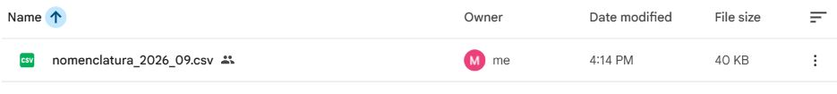

# Recuperación del catálogo histórico

Fecha: 3 de noviembre de 2026. Implementación: Marco. Revisión: Diego Hurtado.

La consulta directa a https://mibici.net/es/datos-abiertos/ devolvió como catálogo publicado `nomenclatura_2026_10.csv`. La descarga de septiembre con la identificación HTTP del proyecto devuelve 404. Octubre responde 200, contiene 470 filas y tiene una huella distinta; no se adoptó como sustituto del catálogo histórico.

Se localizó y respaldó la copia original de septiembre fuera del repositorio. La ejecución real de `python -B -m mibici_equipo39.prepare_catalog`, con `MIBICI_SOURCE_CACHE` configurada, recuperó el archivo en `data/external/` y confirmó:

- 484 estaciones, 40,841 bytes, UTF-8 con BOM y separador coma.
- SHA256: `206e45fe633922b634d858142fa21e6fd9f4c421b6435c02980ef290cc2df90d`.
- Coincidencia exacta con `references/data_manifest.json`.
- Recuperación: `verified_cache`.

Se ejecutaron `tests/test_download.py`, `tests/test_data.py`, `tests/test_ingesta_calidad.py` y `tests/test_station_manifest.py`: **51 pruebas aprobadas, 0 fallos, 14 advertencias**, en 15.67 segundos. Cubren descarga HTTP, respaldo local, fuente HTTPS alternativa, rechazo de hashes diferentes, limpieza de archivos parciales y repetición de la ingesta sintética. La primera ejecución encontró errores de preparación porque faltaba la carpeta padre de temporales; se creó y la suite se repitió completa.

## Respaldo compartido y descarga real

Marco proporcionó una carpeta de Google Drive y autorizó lectura mediante enlace únicamente para el CSV. Se subió el archivo original sin modificarlo. Los permisos de la carpeta no cambiaron.

- [Archivo de respaldo](https://drive.google.com/file/d/1O48-8Mnav45t60JtcKTka7G2QPiUCttS/view).
- [Metadatos y fuente original](../../references/stations_backup.json).
- [Resultado de la descarga y recuperación](verificacion_respaldo_drive_20261103.json).

La descarga directa sin cookies ni sesión de Google devolvió HTTP 200, 40,841 bytes y el SHA256 del manifiesto. Después se ejecutó `python -B -m mibici_equipo39.prepare_catalog` desde un directorio nuevo que no contenía el catálogo, sin `MIBICI_SOURCE_CACHE` ni una URL configurada mediante variables de entorno. La fuente oficial falló y el programa recuperó el respaldo configurado en `config.py`: `retrieval=verified_backup`, 484 filas y `matches_manifest=true`.

Tras fijar la URL predeterminada se repitieron los cuatro archivos de pruebas antes indicados: **51 aprobadas, 0 fallos y 14 advertencias**, en 17.65 s. Las advertencias son deprecaciones de Pyparsing en Matplotlib. No se repitieron los doce meses de viajes ni el entrenamiento; esta comprobación resuelve la recuperación del catálogo histórico y no acredita por sí sola la reproducción completa del proyecto.

La disponibilidad remota depende de conservar el archivo y su permiso de lectura en Drive. El programa sigue validando su huella y rechaza cualquier reemplazo o página de acceso. `MIBICI_STATIONS_BACKUP_URL` permite cambiar la ubicación y un valor vacío desactiva el respaldo remoto.

La imagen muestra la fila del archivo en Drive mediante una captura de detalle del navegador, sin editar el contenido. SHA256 de la imagen: `11438463eae2adbbfad17131cdee844e2e453f82a50ea4a85160899a32e74079`.

El manifiesto, las selecciones y los modelos oficiales no se modificaron. La ingesta en modo `verify` acepta exclusivamente la huella ya registrada. El CSV no se incorpora al repositorio.
