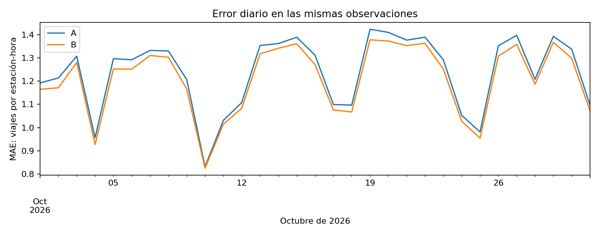

# Comparación de P1: A frente a B

Estado: resultados ejecutados por Marco el 11 de noviembre de 2026; revisión independiente de Diego Hurtado pendiente.

## Versiones y diseño

Repositorio: https://github.com/makroem/TC5061-Proyecto-Equipo39

Ambos modelos pertenecen a `mibici-equipo39-p1-demanda`. A es la versión 1 (`66414a8b45164d3a8f5b9f42e7cb387b`); B es la versión 2 (`741ed805a55a49b3bb0bb95a4682b1f2`). La evaluación vigente es `93f298b2c1404a8bb8a4eb1bed83b4bb`, ejecutada con el código `f3c8af0b5931e1551b6c1b5a87858382998e7f44` y árbol limpio al inicio. Las instrucciones están en [reproduccion.md](../../references/etapa5/reproduccion.md).

A se entrenó entre octubre de 2025 y mayo de 2026. B actualiza la misma media por estación, día y hora usando octubre de 2025 a septiembre de 2026: 3,232,440 filas de 369 estaciones. La evaluación utiliza las mismas 274,536 claves estación-hora de octubre de 2026 para ambos modelos. No se ajustó B con ese mes. Es una comparación retrospectiva pareada, sin asignación de tráfico ni inferencia causal.

## Resultados globales

| Medida | A, versión 1 | B, versión 2 | Lectura |
|---|---:|---:|---|
| MAE, viajes por estación-hora | 1.239267 | 1.208781 | Mejora de 2.46% |
| RMSE, viajes por estación-hora | 2.440745 | 2.379533 | Mejora de 2.51% |
| Latencia mediana, lote de 1,000 filas, ms | 30.27 | 26.69 | Mismo entorno, 30 repeticiones alternadas |
| Latencia p95, lote de 1,000 filas, ms | 38.22 | 33.89 | No mide una petición HTTP ni garantiza un SLA |
| Modelo serializado, bytes | 1,121,792 | 1,121,511 | Tamaños prácticamente iguales |
| Tiempo de ajuste, segundos | No disponible | 1.764 | No existe un tiempo de A medido en condiciones comparables |

Los paquetes completos incluyen código y metadatos: A ocupa 1,274,894 bytes y B 1,371,385. La diferencia no debe atribuirse únicamente al modelo estadístico. El tiempo de B corresponde al ajuste en memoria, sin descarga, preparación ni registro. La latencia excluye carga inicial y transporte de la API. Los costos no se extrapolan a moneda ni a infraestructura de producción.

## Estabilidad y segmentos

La diferencia MAE(B)−MAE(A) es -0.030487, con intervalo exploratorio del 95% [-0.032590, -0.027244]. Se usaron 1,000 remuestreos de bloques móviles de siete días, manteniendo las estaciones y los pares A/B juntos. El intervalo favorece a B dentro de este mes, pero 31 días no prueban estabilidad anual.

La mejora de MAE se mantiene entre 2.11% y 2.71% en las cinco fracciones semanales; la última tiene tres días y no se interpreta como una semana completa. Hay 21 estaciones cuyo MAE empeora. A la 01:00, el MAE aumenta de 0.000932 a 0.001341: 44.00% relativo, pero solo 0.000410 viajes por estación-hora en términos absolutos. Por ello se muestran ambas escalas. El protocolo trata todas las horas como segmentos prioritarios y ese caso incumple el límite relativo de 10%. No se cambió el criterio después de ver los resultados. Cuando A tiene MAE cero, no se informa mejora porcentual; la comprobación absoluta permite igualdad en cero.

La figura es una gráfica calculada con las observaciones evaluadas, no una captura de la interfaz de MLflow.

## Decisión

Se recomienda conservar A. B mejora, pero no alcanza el mínimo de 5% de MAE fijado antes de la comparación y falla el criterio relativo de un segmento horario. RMSE, intervalo y latencia sí satisfacen sus condiciones. `champion` continúa en la versión 1 y B permanece registrada como candidata. La decisión final debe revisar también la importancia operacional de las horas de demanda casi nula; un eventual cambio de umbral requiere un protocolo nuevo y validación posterior, no una reinterpretación de esta entrega.

## Límites y observaciones

La evaluación se restringe a la cohorte de A; 55,835 salidas actuales quedan fuera de ella. Hay una salida sin correspondencia en el catálogo y la estación 175 tiene cero salidas durante octubre, sin evidencia suficiente para establecer si estuvo cerrada. Se conservan esos límites en [datos_resumen.json](datos_resumen.json).

El artefacto histórico de A declara dependencias anteriores a la migración. Ambos modelos se cargaron y evaluaron en el mismo entorno vigente, con firmas idénticas y predicciones finitas/no negativas; las diferencias declaradas se documentan en `entorno_evaluacion.json`. No se reinstalaron las dependencias antiguas ni se modificó A.

El entrenamiento de B guardó correctamente modelo y artefactos, pero la impresión Unicode de la consola interrumpió su cierre. Se verificó la versión y se cerró la misma corrida en UTF-8, sin repetir el ajuste. El registro de recuperación está en `cierre_corrida_b.json`. La evaluación vigente exige versiones READY y corridas FINISHED.
