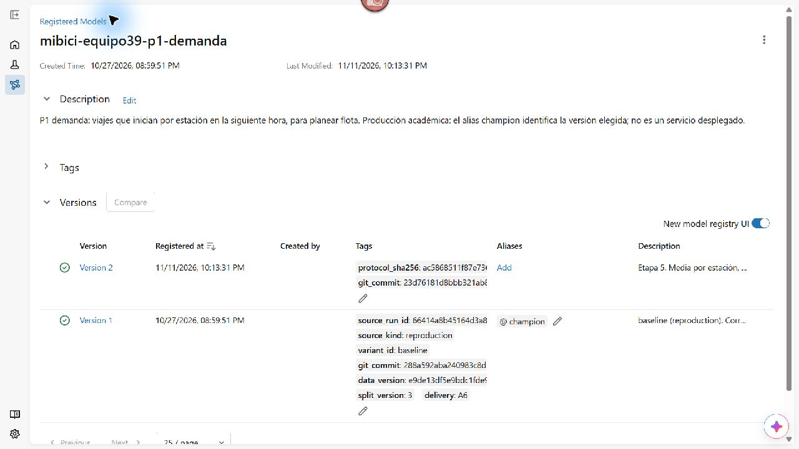
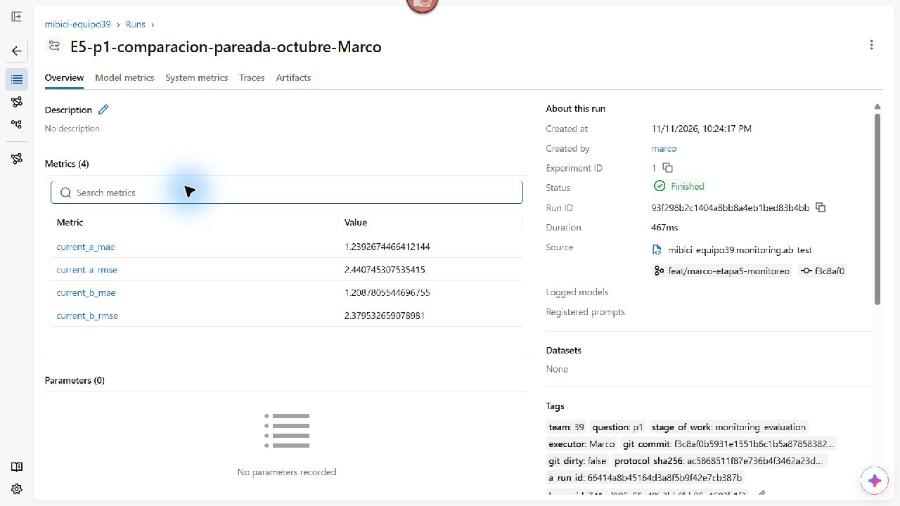

# Capturas originales de Evidently y MLflow

Fecha: 12 de noviembre de 2026. Responsable de la evidencia: Marco.

Origen de Evidently: `reports/etapa5/drift.html`, abierto mediante el servidor local `http://127.0.0.1:8765/drift.html`. Origen de MLflow: la interfaz del servidor existente en `http://127.0.0.1:5000`, abierta en Chrome. Las capturas corresponden al registro y a los resultados existentes; la fecha de captura no representa una nueva ejecución del monitoreo.

| Archivo | Contenido y alcance |
|---|---|
| [01_evidently_resumen.jpg](01_evidently_resumen.jpg) | Resumen y nueve variables: tres con drift, proporción 0.333 y umbral global de 0.5. |
| [02_evidently_calidad.jpg](02_evidently_calidad.jpg) | Resumen de los dos conjuntos muestreados: 100,000 filas, nueve columnas, sin valores faltantes y tres columnas constantes en el conjunto actual. |
| [03_evidently_mes.jpg](03_evidently_mes.jpg) | Distribución de mes: el conjunto actual contiene octubre y la referencia incluye ocho meses. |
| [01_evidently_reporte_completo.jpg](01_evidently_reporte_completo.jpg) | Captura vertical completa, con resumen, calidad y perfiles de las nueve variables. Abrir la imagen original para consultar los detalles. |
| [04_registry_p1_versiones.jpg](04_registry_p1_versiones.jpg) | Registro `mibici-equipo39-p1-demanda`: versiones 1 y 2; `champion` permanece en la versión 1. |
| [05_registry_a_champion_linaje.jpg](05_registry_a_champion_linaje.jpg) | Versión A, alias `champion`, corrida de origen, descripción y etiquetas de datos y código. |
| [06_registry_b_candidata_linaje.jpg](06_registry_b_candidata_linaje.jpg) | Versión B candidata, corrida de origen, periodo de entrenamiento, commit y huella del protocolo. Sin alias de producción. |
| [07_mlflow_comparacion_ab_octubre.jpg](07_mlflow_comparacion_ab_octubre.jpg) | Corrida finalizada de evaluación pareada: MAE y RMSE de A y B sobre las mismas observaciones de octubre. |
| [08_mlflow_trazabilidad_ab.jpg](08_mlflow_trazabilidad_ab.jpg) | Etiquetas de la evaluación: equipo, pregunta, responsable, commit, protocolo y corridas de origen de A y B. |

Las cuatro imágenes de Evidently son capturas directas del HTML renderizado: tres regiones del reporte y una página completa. Las cinco de MLflow son capturas de la ventana de Chrome en pantalla completa, con la navegación lateral contraída. No se reconstruyeron tablas ni se editaron los píxeles. Se conservan los JPEG originales; [manifest.json](manifest.json) registra dimensiones, huellas SHA-256 y procedencia.

## Interpretación

No se detecta drift global porque la proporción 3/9 es menor que el umbral 0.5. Sí se detectan cambios en `month`, `month_sin` y `month_cos`. La ausencia de alerta global no garantiza precisión del modelo. Las 100,000 filas por conjunto pertenecen al muestreo de drift; la evaluación A/B utiliza 274,536 observaciones y está documentada por separado.

## Linaje de la comparación

| Elemento | Identificador |
|---|---|
| Modelo registrado | `mibici-equipo39-p1-demanda` |
| A: versión 1, `champion` | Corrida `66414a8b45164d3a8f5b9f42e7cb387b` |
| B: versión 2, candidata | Corrida `741ed805a55a49b3bb0bb95a4682b1f2` |
| Evaluación pareada de octubre | Corrida `93f298b2c1404a8bb8a4eb1bed83b4bb` |

La captura de evaluación reúne `current_a_mae = 1.2392674466412144`, `current_b_mae = 1.2087805544696755`, `current_a_rmse = 2.440745307535415` y `current_b_rmse = 2.379532659078981`. Esta corrida evalúa modelos existentes; por eso no crea un nuevo modelo registrado. Las corridas de origen de A y B se muestran en las etiquetas. La mejora de MAE es 2.46%; la decisión documentada conserva A como `champion`.

## Revisión pendiente

La revisión visual por Marco no equivale a la revisión independiente de Diego Hurtado ni a una aprobación del PR #64. El reporte final de entrega aún debe integrarse. Las capturas no cambian modelos, métricas, umbrales ni alias.
